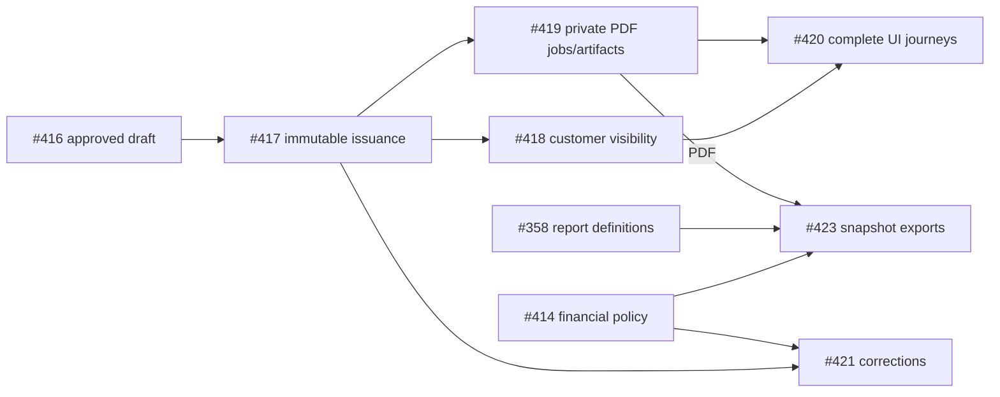

# V1 source, deployment and acceptance reconciliation

Evidence checkpoint: **2026-10-28 UTC**. Release decision: **PARTIAL — mandatory engineering and acceptance remain**.

## Current source and runtime

- Source and independently verified VPS release: `92b23a43aa095a563d798712d24d1ffdf8020f14`; all six application services match the published digests and runtime version. [Combined main CI](https://github.com/Hordekiller/Iraniyaragh/actions/runs/40690896740), [official image publication](https://github.com/Hordekiller/Iraniyaragh/actions/runs/40690896810), [deployment/restore/smoke evidence](https://github.com/Hordekiller/Iraniyaragh/pull/470#issuecomment-6471511791).
- Fresh private database backup restored in an isolated container (109 tables, 67 completed migrations); media manifest sizes/checksums verified. Official deploy performed its mandatory pre-migration backup. No schema migration was added by dependency PRs #470/#478.
- Public HTTPS, API readiness, Admin and actual server-readable Persian catalog/product/policy HTML, canonicals, sitemap, 308/404 and mobile labels passed. The served Admin bundle contains the #480 Jodit save fix.
- Staging/provider modes are unchanged. Global `noindex`/robots Disallow remain active. No live payment/SMS, financial/stock mutation or new operator acceptance was fabricated. No V1 tag was created.
- Rollback: `./scripts/deploy/rollback.sh 1da785d5e0cd8afe624cd2c0d78a114c6b80f0d5`. Current and rollback images plus verified private backups were preserved.
- Post-deploy disk cleanup removed four obsolete PDF image tags and unused build cache older than 24 hours. BuildKit reported 6.165 GB reclaimed; host free space rose from about 2.2 GiB (95% used) to about 11 GiB (74% used). No volume, sales record or backup was deleted. Docker image/cache sizes contain shared layers and cannot be added blindly.

## Scope and evidence rules

`ACCEPTED` applies to the original bounded issue criteria, not blanket real-world V1 acceptance. `DEPLOYED_NOT_ACCEPTED` identifies delivered code with remaining operator/provider evidence. `PARTIAL` records specific missing behavior; `MISSING` identifies a main-branch runtime gap, including implementations present only on unmerged branches. `BLOCKED` requires an external decision/action. `OUT_OF_SCOPE` is explicitly post-V1. No new `BROKEN` or `MERGED_NOT_DEPLOYED` state was established for this checkpoint.

All 48 previously open issues were reconciled against their bodies and current source. Test-only #352 and architecture-decision #338 meet their bounded criteria and were closed with evidence; physical warehouse acceptance remains #347/#8 and credit returns/refund acceptance remains #431. The remaining 46 issues have a current disposition, evidence link and next action on GitHub. The previously omitted closed #458 carousel issue was added, giving 151 total issues (46 open / 105 closed). Historical closed issues retain their state; closure alone does not establish acceptance.

### Required engineering and remaining acceptance

1. Release-critical operations: approved ClamAV route/loaded-signature freshness #393 (reuse #468), payment-aware worker and real commerce/session/SMS acceptance #450/#81/#400/#403; preserve uncertainty and inactive modes.
2. Missing mandatory product scope: role administration #359, general paid-order returns #348, invoice corrections #421 and governed articles #125. Reuse current services and the access candidate `301bdf3`; do not duplicate them.
3. Complete applicable guide/content rendering #126, Merchant feed #127, remaining IndexNow/content invalidation #129 and field/operational acceptance #123/#130/#136. Existing SSR, robots/sitemaps and structured data must not be rebuilt.
4. Reconcile Admin/customer/invoice/report/warehouse acceptance through existing parent gates. Inventory valuation #422 stays intentionally inactive pending approved evidence; it is not permission to invent costs or delay unrelated delivery. AI retrieval #128, multi-provider #141 and broad breaking dependency upgrades #77 are post-V1.

### Issue dispositions

| Issue | Current state | Source evidence and next action |
| --- | --- | --- |
| [#2](https://github.com/Hordekiller/Iraniyaragh/issues/2) | PARTIAL | [auth.guard.ts](https://github.com/Hordekiller/Iraniyaragh/blob/92b23a43aa095a563d798712d24d1ffdf8020f14/apps/api/src/modules/auth/auth.guard.ts). Foundation/auth/session/permissions/audit delivered. Runtime access management #359 and remaining operational acceptance prevent blanket foundation/release completion. |
| [#4](https://github.com/Hordekiller/Iraniyaragh/issues/4) | DEPLOYED_NOT_ACCEPTED | [inventory.service.ts](https://github.com/Hordekiller/Iraniyaragh/blob/92b23a43aa095a563d798712d24d1ffdf8020f14/apps/api/src/modules/inventory/inventory.service.ts). Ledger/reservation/transfer implementations and concurrency tests delivered; controlled worker and full warehouse operator acceptance remain #450/#347. |
| [#5](https://github.com/Hordekiller/Iraniyaragh/issues/5) | DEPLOYED_NOT_ACCEPTED | [order-command.service.ts](https://github.com/Hordekiller/Iraniyaragh/blob/92b23a43aa095a563d798712d24d1ffdf8020f14/apps/api/src/modules/orders/order-command.service.ts). Real cart, checkout, immutable order snapshots and Admin commands implemented; final customer/operator lifecycle acceptance remains #389/#401/#450. |
| [#6](https://github.com/Hordekiller/Iraniyaragh/issues/6) | DEPLOYED_NOT_ACCEPTED | [OPERATIONS.md](https://github.com/Hordekiller/Iraniyaragh/blob/92b23a43aa095a563d798712d24d1ffdf8020f14/docs/OPERATIONS.md). Verified callback/payment/fulfillment/shipment/notification implementations exist and controlled historical evidence is bounded. Provider, uncertainty/refund and full dispatch/delivery acceptance remain. |
| [#7](https://github.com/Hordekiller/Iraniyaragh/issues/7) | PARTIAL | [stocktake.service.ts](https://github.com/Hordekiller/Iraniyaragh/blob/92b23a43aa095a563d798712d24d1ffdf8020f14/apps/api/src/modules/stocktake/stocktake.service.ts). Purchasing/receiving/stocktake and operational reports deployed; general paid-order returns #348, final warehouse UAT and applicable financial gates remain. |
| [#8](https://github.com/Hordekiller/Iraniyaragh/issues/8) | PARTIAL | [V1_RECONCILIATION.md](https://github.com/Hordekiller/Iraniyaragh/blob/92b23a43aa095a563d798712d24d1ffdf8020f14/docs/V1_RECONCILIATION.md). Latest main is deployed with exact image digests, restored backup and public smoke. V1 tag remains withheld: access, general returns, corrections, articles and operational acceptance remain. |
| [#77](https://github.com/Hordekiller/Iraniyaragh/issues/77) | OUT_OF_SCOPE | [dependabot.yml](https://github.com/Hordekiller/Iraniyaragh/blob/92b23a43aa095a563d798712d24d1ffdf8020f14/.github/dependabot.yml). Owner deferred the broad breaking framework/tool train for V1. Compatible patch/minor updates #470/#478 landed. Prisma 7, Nest Swagger 12 and other breaking candidates need a separate post-V1 decision, not automatic merge. |
| [#81](https://github.com/Hordekiller/Iraniyaragh/issues/81) | DEPLOYED_NOT_ACCEPTED | [inventory-expiry.integration-spec.ts](https://github.com/Hordekiller/Iraniyaragh/blob/92b23a43aa095a563d798712d24d1ffdf8020f14/apps/api/src/modules/inventory/inventory-expiry.integration-spec.ts). Grouped bounded reservation expiry and PostgreSQL query/concurrency evidence merged through #464. Keep runtime enablement and controlled live reconciliation linked to #450. |
| [#122](https://github.com/Hordekiller/Iraniyaragh/issues/122) | PARTIAL | [SEO_GEO_AI_DISCOVERY_PLAN.md](https://github.com/Hordekiller/Iraniyaragh/blob/92b23a43aa095a563d798712d24d1ffdf8020f14/docs/SEO_GEO_AI_DISCOVERY_PLAN.md). Accepted rendering migration and lifecycle-safe catalog discovery deployed. Articles, Merchant feed, IndexNow and field acceptance remain; AI retrieval #128 is post-V1. |
| [#123](https://github.com/Hordekiller/Iraniyaragh/issues/123) | PARTIAL | [discovery-audit.yml](https://github.com/Hordekiller/Iraniyaragh/blob/92b23a43aa095a563d798712d24d1ffdf8020f14/.github/workflows/discovery-audit.yml). Discovery contracts, no-JS/browser and route/provenance checks exist. Production audit origin, field budgets/RUM/alert owners and 30-day evidence remain; no test pass substitutes for field acceptance. |
| [#125](https://github.com/Hordekiller/Iraniyaragh/issues/125) | MISSING | [content](https://github.com/Hordekiller/Iraniyaragh/blob/92b23a43aa095a563d798712d24d1ffdf8020f14/apps/api/src/modules/content). No governed article/revision/scheduling/media-ownership API/Admin lifecycle. Product Jodit and sanitizer are reusable dependencies, not article management. |
| [#126](https://github.com/Hordekiller/Iraniyaragh/issues/126) | PARTIAL | [page.tsx](https://github.com/Hordekiller/Iraniyaragh/blob/92b23a43aa095a563d798712d24d1ffdf8020f14/apps/web/src/app/page.tsx). Server-readable home/catalog/category/brand/product/policy HTML, canonicals and real 308/404 deployed via #481. Guide/article templates await #125; global staging noindex remains deliberately active. |
| [#127](https://github.com/Hordekiller/Iraniyaragh/issues/127) | PARTIAL | [structured-data.tsx](https://github.com/Hordekiller/Iraniyaragh/blob/92b23a43aa095a563d798712d24d1ffdf8020f14/apps/web/src/server/structured-data.tsx). Public projection-backed Product/Offer and Breadcrumb structured data deployed. Merchant feed/parity and unsupported policy/schema branches remain; never fabricate ratings/GTIN/stock/price. |
| [#128](https://github.com/Hordekiller/Iraniyaragh/issues/128) | OUT_OF_SCOPE | [SEO_GEO_AI_DISCOVERY_PLAN.md](https://github.com/Hordekiller/Iraniyaragh/blob/92b23a43aa095a563d798712d24d1ffdf8020f14/docs/SEO_GEO_AI_DISCOVERY_PLAN.md). AI retrieval is explicitly post-V1 and must not block commerce. Requires separate provider/data-retention policy and safety/evaluation evidence. |
| [#129](https://github.com/Hordekiller/Iraniyaragh/issues/129) | PARTIAL | [discovery.service.ts](https://github.com/Hordekiller/Iraniyaragh/blob/92b23a43aa095a563d798712d24d1ffdf8020f14/apps/api/src/modules/discovery/discovery.service.ts). Dynamic gzip sitemap index/shards, canonical robots, ETag/freshness/rate bounds deployed via #481. Content shards await #125 and IndexNow worker/DLQ/outbox invalidation are not delivered; keep issue open. |
| [#130](https://github.com/Hordekiller/Iraniyaragh/issues/130) | PARTIAL | [discovery.policy.ts](https://github.com/Hordekiller/Iraniyaragh/blob/92b23a43aa095a563d798712d24d1ffdf8020f14/apps/api/src/modules/discovery/discovery.policy.ts). Robots policy and rate/capacity controls exist. Verified-bot governance, reviewed training/search policy, citation baseline and optional experiment acceptance remain; no AI citation promise. |
| [#136](https://github.com/Hordekiller/Iraniyaragh/issues/136) | PARTIAL | [OPERATIONS.md](https://github.com/Hordekiller/Iraniyaragh/blob/92b23a43aa095a563d798712d24d1ffdf8020f14/docs/OPERATIONS.md). Structured/redacted diagnostics, readiness and worker reliability exist; alert delivery/ownership/recovery acceptance still requires evidence. Host disk was cleaned after verified deployment. |
| [#140](https://github.com/Hordekiller/Iraniyaragh/issues/140) | PARTIAL | [catalog.ts](https://github.com/Hordekiller/Iraniyaragh/blob/92b23a43aa095a563d798712d24d1ffdf8020f14/apps/web/src/server/catalog.ts). Dynamic catalog/public rendering delivered; governed articles/content lifecycle #125 and full customer UAT remain. |
| [#141](https://github.com/Hordekiller/Iraniyaragh/issues/141) | OUT_OF_SCOPE | [PRODUCT_SPEC.md](https://github.com/Hordekiller/Iraniyaragh/blob/92b23a43aa095a563d798712d24d1ffdf8020f14/docs/PRODUCT_SPEC.md). Explicit V1.1+ scope: multi-provider orchestration. V1 retains one selected SMS/payment provider and uncertain-result reconciliation. |
| [#213](https://github.com/Hordekiller/Iraniyaragh/issues/213) | BLOCKED | [REPOSITORY_WORKFLOW.md](https://github.com/Hordekiller/Iraniyaragh/blob/92b23a43aa095a563d798712d24d1ffdf8020f14/docs/REPOSITORY_WORKFLOW.md). Exact-head and main Sonar scans/quality gates now pass. Only organization administrator confirmation of account/suspension state can close the original external account issue. |
| [#252](https://github.com/Hordekiller/Iraniyaragh/issues/252) | PARTIAL | [navigation.ts](https://github.com/Hordekiller/Iraniyaragh/blob/92b23a43aa095a563d798712d24d1ffdf8020f14/apps/admin/src/config/navigation.ts). Vuexy-inspired project-owned Admin surfaces exist. Runtime access management #359 and complete approved workflow acceptance remain. Never copy the licensed reference wholesale. |
| [#258](https://github.com/Hordekiller/Iraniyaragh/issues/258) | DEPLOYED_NOT_ACCEPTED | [layout.tsx](https://github.com/Hordekiller/Iraniyaragh/blob/92b23a43aa095a563d798712d24d1ffdf8020f14/apps/web/src/app/layout.tsx). Shared UI, real customer commerce APIs and accepted Next public rendering deployed with asset/fixture guards; final route-by-route real responsive UAT remains. |
| [#338](https://github.com/Hordekiller/Iraniyaragh/issues/338) | ACCEPTED | [0023-customer-credit-and-receivable-ledger.md](https://github.com/Hordekiller/Iraniyaragh/blob/92b23a43aa095a563d798712d24d1ffdf8020f14/docs/adr/0023-customer-credit-and-receivable-ledger.md). Bounded architecture decision delivered in ADR-0023 and reviewed through dedicated credit implementation #427/#428; staff-only channel, receivables/allocations and inventory coupling exist. Separate returns/operator gate #431 remains open. |
| [#347](https://github.com/Hordekiller/Iraniyaragh/issues/347) | DEPLOYED_NOT_ACCEPTED | [stocktake.service.ts](https://github.com/Hordekiller/Iraniyaragh/blob/92b23a43aa095a563d798712d24d1ffdf8020f14/apps/api/src/modules/stocktake/stocktake.service.ts). Stocktake session/review/ledger reconciliation and full two-location browser coverage deployed (#411/#444). Retain live physical-count operator acceptance; test scope separately closed in #352. |
| [#348](https://github.com/Hordekiller/Iraniyaragh/issues/348) | MISSING | [credit-return.service.ts](https://github.com/Hordekiller/Iraniyaragh/blob/92b23a43aa095a563d798712d24d1ffdf8020f14/apps/api/src/modules/credit/credit-return.service.ts). No general paid-order return workflow. Inventory RETURN_IN primitives and the credit-sale-only return command do not satisfy paid-order returns/refund linkage. Reuse their invariants, not their eligibility assumptions. |
| [#352](https://github.com/Hordekiller/Iraniyaragh/issues/352) | ACCEPTED | [admin-stocktake.spec.ts](https://github.com/Hordekiller/Iraniyaragh/blob/92b23a43aa095a563d798712d24d1ffdf8020f14/e2e/tests/admin-stocktake.spec.ts). Bounded test-only task satisfied: PostgreSQL invariants/concurrency/blind reads, HTTP permissions/DTO bounds, Admin uncertainty/permissions, and real desktop/mobile two-location up/down E2E. #444 merged and combined main CI passed. Live physical-count acceptance remains #347/#8. |
| [#353](https://github.com/Hordekiller/Iraniyaragh/issues/353) | PARTIAL | [navigation.ts](https://github.com/Hordekiller/Iraniyaragh/blob/92b23a43aa095a563d798712d24d1ffdf8020f14/apps/admin/src/config/navigation.ts). Audit/shipments/customers/reports surfaces delivered; runtime role/permission administration #359 and final Admin acceptance remain. |
| [#358](https://github.com/Hordekiller/Iraniyaragh/issues/358) | PARTIAL | [report-export-job.service.ts](https://github.com/Hordekiller/Iraniyaragh/blob/92b23a43aa095a563d798712d24d1ffdf8020f14/apps/api/src/modules/reports/report-export-job.service.ts). Operational reports and owned durable CSV/XLSX/PDF exports #476 deployed. Correction-document reporting #421 and integrated acceptance remain; valuation #422 intentionally inactive. |
| [#359](https://github.com/Hordekiller/Iraniyaragh/issues/359) | MISSING | [navigation.ts](https://github.com/Hordekiller/Iraniyaragh/blob/92b23a43aa095a563d798712d24d1ffdf8020f14/apps/admin/src/config/navigation.ts). No access module or /access page on main. Local candidate commit 301bdf3 exists on feat/v1-completion; preserve it, integrate/review security and pass fresh CI before claiming delivery. |
| [#363](https://github.com/Hordekiller/Iraniyaragh/issues/363) | PARTIAL | [V1_RECONCILIATION.md](https://github.com/Hordekiller/Iraniyaragh/blob/92b23a43aa095a563d798712d24d1ffdf8020f14/docs/V1_RECONCILIATION.md). Use the current release reconciliation and live issue dispositions. Old lane allocation is historical. V1 remains incomplete because mandatory engineering and operator gates remain. |
| [#388](https://github.com/Hordekiller/Iraniyaragh/issues/388) | PARTIAL | [catalog](https://github.com/Hordekiller/Iraniyaragh/blob/92b23a43aa095a563d798712d24d1ffdf8020f14/apps/admin/src/components/catalog). Product save/Jodit fixes #473/#475/#480 deployed and tested, including long Persian HTML/reload/replay. Broader master-data/media/publish/operator acceptance and scanner freshness remain. |
| [#389](https://github.com/Hordekiller/Iraniyaragh/issues/389) | DEPLOYED_NOT_ACCEPTED | [AccountPage.tsx](https://github.com/Hordekiller/Iraniyaragh/blob/92b23a43aa095a563d798712d24d1ffdf8020f14/apps/web/src/views/AccountPage.tsx). Owned profile/addresses/security/orders/cart UI and APIs exist. Complete fixture-disabled customer lifecycle, reload and ownership/session acceptance; do not infer verified identity changes. |
| [#393](https://github.com/Hordekiller/Iraniyaragh/issues/393) | PARTIAL | [compose.staging.yml](https://github.com/Hordekiller/Iraniyaragh/blob/92b23a43aa095a563d798712d24d1ffdf8020f14/infrastructure/docker/compose.staging.yml). Pinned scanner process health does not prove current signatures. Existing PR #468 is the reusable route/freshness candidate; approved updater route and daemon-loaded freshness/real scan acceptance remain. |
| [#400](https://github.com/Hordekiller/Iraniyaragh/issues/400) | DEPLOYED_NOT_ACCEPTED | [auth](https://github.com/Hordekiller/Iraniyaragh/blob/92b23a43aa095a563d798712d24d1ffdf8020f14/apps/admin/src/lib/auth). Protected replay/session refresh fixes #445/#447 and Jodit save recovery #480 are deployed. Real authenticated idle/reload/mutation acceptance is still distinct from CI. |
| [#401](https://github.com/Hordekiller/Iraniyaragh/issues/401) | DEPLOYED_NOT_ACCEPTED | [MobileBottomNav.tsx](https://github.com/Hordekiller/Iraniyaragh/blob/92b23a43aa095a563d798712d24d1ffdf8020f14/apps/web/src/components/layout/MobileBottomNav.tsx). Hero slider, mobile order tracking and account UI deployed; #470 mobile labels fixed. Complete real responsive session/reload/error/customer ownership acceptance with #389/#403. |
| [#403](https://github.com/Hordekiller/Iraniyaragh/issues/403) | DEPLOYED_NOT_ACCEPTED | [SMS_IR_TEMPLATE_COPY.md](https://github.com/Hordekiller/Iraniyaragh/blob/92b23a43aa095a563d798712d24d1ffdf8020f14/docs/SMS_IR_TEMPLATE_COPY.md). Historical operator-attested OTP/order-paid receipt is not full SMS acceptance. Dispatch/delivery handset, failure/replay and full session evidence remain; no new message was sent. |
| [#413](https://github.com/Hordekiller/Iraniyaragh/issues/413) | PARTIAL | [invoices.module.ts](https://github.com/Hordekiller/Iraniyaragh/blob/92b23a43aa095a563d798712d24d1ffdf8020f14/apps/api/src/modules/invoices/invoices.module.ts). Policy, drafts, issuance, publication, private PDF and CSV/XLSX/PDF report snapshots deployed. Corrections and integrated operator acceptance remain; do not rebuild delivered services. |
| [#414](https://github.com/Hordekiller/Iraniyaragh/issues/414) | PARTIAL | [0024-store-invoice-policy.md](https://github.com/Hordekiller/Iraniyaragh/blob/92b23a43aa095a563d798712d24d1ffdf8020f14/docs/adr/0024-store-invoice-policy.md). Store-invoice policy/draft/issuance/PDF ADRs and contracts exist; reconcile pending correction/credit-document lifecycle decisions and explicit external fiscal boundaries. |
| [#415](https://github.com/Hordekiller/Iraniyaragh/issues/415) | DEPLOYED_NOT_ACCEPTED | [invoice-quote.ts](https://github.com/Hordekiller/Iraniyaragh/blob/92b23a43aa095a563d798712d24d1ffdf8020f14/apps/api/src/modules/invoices/invoice-quote.ts). Versioned seller/tax/discount policy and exact IRR arithmetic deployed via #429/#430; operator must supply/accept real policy, never infer rates. |
| [#416](https://github.com/Hordekiller/Iraniyaragh/issues/416) | DEPLOYED_NOT_ACCEPTED | [invoice-draft.integration-spec.ts](https://github.com/Hordekiller/Iraniyaragh/blob/92b23a43aa095a563d798712d24d1ffdf8020f14/apps/api/src/modules/invoices/invoice-draft.integration-spec.ts). Versioned independent drafts and real customer/SKU quote workflow deployed via #430; complete controlled operator draft/reload/conflict/issue acceptance under #424. |
| [#417](https://github.com/Hordekiller/Iraniyaragh/issues/417) | DEPLOYED_NOT_ACCEPTED | [invoice-document.integration-spec.ts](https://github.com/Hordekiller/Iraniyaragh/blob/92b23a43aa095a563d798712d24d1ffdf8020f14/apps/api/src/modules/invoices/invoice-document.integration-spec.ts). Atomic numbering and immutable issued snapshots/SQL guards deployed via #433; collect controlled invoice financial acceptance without rewriting originals. |
| [#418](https://github.com/Hordekiller/Iraniyaragh/issues/418) | DEPLOYED_NOT_ACCEPTED | [invoice-publication.service.ts](https://github.com/Hordekiller/Iraniyaragh/blob/92b23a43aa095a563d798712d24d1ffdf8020f14/apps/api/src/modules/invoices/invoice-publication.service.ts). Publication/revocation and current-owner private reads deployed via #434/#449; remaining integrated two-customer operator acceptance belongs to #424. |
| [#420](https://github.com/Hordekiller/Iraniyaragh/issues/420) | DEPLOYED_NOT_ACCEPTED | [InvoicePdfActions.tsx](https://github.com/Hordekiller/Iraniyaragh/blob/92b23a43aa095a563d798712d24d1ffdf8020f14/apps/admin/src/components/invoices/InvoicePdfActions.tsx). Admin drafts/issuance/publication and owned customer PDF interfaces exist, including #449; controlled draft-edit-issue-publish-owner-download-revoke operator journey remains. |
| [#421](https://github.com/Hordekiller/Iraniyaragh/issues/421) | MISSING | [invoice-document.service.ts](https://github.com/Hordekiller/Iraniyaragh/blob/92b23a43aa095a563d798712d24d1ffdf8020f14/apps/api/src/modules/invoices/invoice-document.service.ts). Implement append-only linked correction/cancellation documents and signed deltas through existing authoritative financial commands; issued originals must remain immutable. |
| [#422](https://github.com/Hordekiller/Iraniyaragh/issues/422) | BLOCKED | [inventory-cost-policy.service.ts](https://github.com/Hordekiller/Iraniyaragh/blob/92b23a43aa095a563d798712d24d1ffdf8020f14/apps/api/src/modules/inventory/inventory-cost-policy.service.ts). Owner explicitly keeps valuation inactive. Cost evidence and approved attribution/opening/return policies are prerequisites; the configuration selector is not a cost ledger. |
| [#424](https://github.com/Hordekiller/Iraniyaragh/issues/424) | PARTIAL | [REPORTING_AND_INVOICE_AUDIT.md](https://github.com/Hordekiller/Iraniyaragh/blob/92b23a43aa095a563d798712d24d1ffdf8020f14/docs/REPORTING_AND_INVOICE_AUDIT.md). Integrated release gate remains open for corrections #421, general returns #348 where applicable, and real invoice/report operator acceptance. Cost valuation #422 stays inactive by owner decision. |
| [#431](https://github.com/Hordekiller/Iraniyaragh/issues/431) | DEPLOYED_NOT_ACCEPTED | [credit-return.service.ts](https://github.com/Hordekiller/Iraniyaragh/blob/92b23a43aa095a563d798712d24d1ffdf8020f14/apps/api/src/modules/credit/credit-return.service.ts). Credit-sale cancellation/returns/refund-liability commands deployed via #432; operator goods/refund evidence acceptance remains. General paid-order returns stay #348. |
| [#450](https://github.com/Hordekiller/Iraniyaragh/issues/450) | DEPLOYED_NOT_ACCEPTED | [order-expiry-runtime.ts](https://github.com/Hordekiller/Iraniyaragh/blob/92b23a43aa095a563d798712d24d1ffdf8020f14/apps/api/src/modules/orders/order-expiry-runtime.ts). Durable payment-aware worker and checkout deadline recovery merged in #464; controlled live expiry/restart/reservation reconciliation remains required. Keep ORDER_EXPIRY_ENABLED unchanged. |

### Disposition of the ten previously open PRs

| PR | Disposition | Action |
| --- | --- | --- |
| [#439](https://github.com/Hordekiller/Iraniyaragh/pull/439) | CLOSED_SUPERSEDED | Template implementation and both test files are byte-identical on main via #449; ADR-0030 on main is a superset. Closed as implemented elsewhere. |
| [#386](https://github.com/Hordekiller/Iraniyaragh/pull/386) | CLOSED_SUPERSEDED | Routing harness is on main; current Next routing and TLS tests supersede the older candidate. Historical status notes are transferred to #487; the older duplicate is closed. |
| [#468](https://github.com/Hordekiller/Iraniyaragh/pull/468) | NEEDS_SYNC | Reusable #393 ClamAV route/freshness candidate; rebase and pass all exact-head checks, then approved live updater acceptance. No automatic mirror/provider change. |
| [#471](https://github.com/Hordekiller/Iraniyaragh/pull/471) | NEEDS_SYNC | Preserve catalog-axis candidate. Reconcile its migration/contracts/Admin and the new Next public templates on latest main before fresh CI; no claim it is deployed. |
| [#460](https://github.com/Hordekiller/Iraniyaragh/pull/460) | DEFERRED | All-products homepage carousel extension remains outside the current V1 critical path; preserve candidate for explicit post-V1 prioritization. |
| [#477](https://github.com/Hordekiller/Iraniyaragh/pull/477) | NEEDS_SYNC | Current workflow bump candidate lacks required successful Analyze/CodeQL contexts (CodeQL skipped). Sync with current main and obtain every required check; no merge bypass. |
| [#483](https://github.com/Hordekiller/Iraniyaragh/pull/483) | CLOSED_DEFERRED | Prisma 7 is a breaking migration under #77. Keep current CLI/client paired at 6.19.3; do not merge during the V1 freeze. |
| [#484](https://github.com/Hordekiller/Iraniyaragh/pull/484) | CLOSED_DEFERRED | class-validator 0.15 and API Playwright 1.64 require compatibility work; PDF Playwright/browser image must move together. Retain working runtime while reviewed separately. |
| [#485](https://github.com/Hordekiller/Iraniyaragh/pull/485) | CLOSED_DEFERRED | eslint-plugin-react-refresh 0.4 to 0.5 is a potentially breaking 0.x family change; review separately after V1. |
| [#486](https://github.com/Hordekiller/Iraniyaragh/pull/486) | CLOSED_DEFERRED | Nest Swagger 12 is a breaking upgrade under #77, separate from supported Nest/API/OpenAPI release work. |

Current open PRs are #460 (deferred), #468 and #471 (source conflicts, needs sync), #477 (required checks incomplete, needs sync), and #487 (this documentation review). Closing a superseded/deferred PR is not a merge or a feature-acceptance claim.

### Dependency alert and branch hygiene

- One low-severity `deepmerge` advisory remains open, with no upstream patched version reported at this checkpoint. The lockfile reverse edge is `fork-ts-checker-webpack-plugin` → `deepmerge`, reached by `@nestjs/cli`; traversal from production importer dependency roots does not reach it. GitHub labels the advisory runtime, so this scoped source result is not an alert dismissal. Follow-up remains #77; no advisory or security control was suppressed.
- All 34 remote branches were inventoried. Only `chore/repository-workflow`, proven an ancestor of main and not bound to a worktree/open PR, was removed. Its exact commit was retained in a local archive ref before the guarded remote deletion. The remaining 33 branches include main, active PR/worktree heads, explicit archives and historical squashed/unmerged heads; those were retained because non-ancestry alone cannot establish safe deletion. No local branch/worktree or uncommitted file was deleted.

No candidate is merged merely for tidiness. Current exact-head protection remains mandatory; skipped/missing CodeQL is not a pass. Local worktrees, untracked files and the original workspace's uncommitted documentation edits remain untouched.

### Historical delivered notes reconciled from #386

- #382 delivered the permission-based Admin baseline; this is not runtime role administration #359.
- #384 corrected deployment execution/path handling; current official deploy completed at the exact selected SHA.
- #385 corrected the Admin canonical routing loop. Main includes the routing harness and evolved Next/TLS regression checks in `e2e/tests/nginx-routing.spec.ts`; current public Admin HTTPS and full CI passed.

## Historical reconciliation snapshots — through 2026-10-20

The following dated snapshots preserve their original evidence. Their source SHAs, open PR lists, missing-feature claims and queues are historical, superseded by the current checkpoint above. They are not current deployment or acceptance assertions.

Evidence checkpoint: **2026-10-20 UTC**. Release decision: **NOT READY — BLOCKERS REMAIN**.
This document supersedes dated execution/status checkpoints, not accepted domain
invariants or historical engineering evidence. It is a working evidence register;
it does not declare the full audit or V1 implementation finished.

> **Status-definition discipline.** The following states are distinct and are never
> collapsed into one word: *Source implemented* / *PR merged* / *CI accepted* /
> *Image published* / *Deployed* / *Operator-runtime accepted* / *Release accepted*.
> A green CI run or a healthy container is not live business acceptance.

## 1. Independent baselines

| Baseline | Observed fact | Limitation |
| --- | --- | --- |
| SOURCE_BASELINE | Fetched `origin/main`: `f4476d83e9791b8f58b7f0a5630837c4a53db54d` | Merged source is not independent business acceptance of every feature |
| DEPLOYED_BASELINE | VPS checkout and API/Admin/Web/media-worker run `7dbd0001959f398635467bedbd7d151c54676599`; `IMAGE_TAG`/`APP_VERSION` bind that SHA; containers healthy | Deployment lags main only by the #444 test-only merge; public smoke and service health do not prove authenticated Admin/customer/financial acceptance |
| RELEASE_REQUIREMENTS | Current owner directive, accepted V1 outcome/exit gates and ADRs, original issue criteria, later approved staff-credit/store-invoice scope | Old staffing/sprint schedules are history; approved safety/domain criteria remain |

`ORDER_EXPIRY_ENABLED=false` remains the fail-closed setting on the deployed
environment pending explicit owner instruction; this is not a claim that order
expiry has been accepted live.

## 1a. Evidence checkpoint — 2026-10-20 UTC

Read-only reconciliation only; no code, deployment, provider send, seed or
financial record was changed by this checkpoint.

| Fact | Observed value |
| --- | --- |
| `origin/main` | `f4476d83e9791b8f58b7f0a5630837c4a53db54d` |
| main required checks | CI, SonarCloud, Publish Images, Production Dependency Audit, Push on main — all success on `f4476d83` |
| Deployed/verified VPS HEAD | `7dbd0001959f398635467bedbd7d151c54676599` |
| VPS drift vs main | one commit: test-only merge #444 (`stocktake two-location reconciliation`) |
| VPS containers | api/admin/web/media-worker healthy; `IMAGE_TAG=7dbd0001…` |
| `ORDER_EXPIRY_ENABLED` | `false` (fail-closed) |
| Runtime provenance | #440 merged 2026-10-19; `compose.staging.yml` binds `APP_VERSION: ${IMAGE_TAG:?…}` per service |

#444 (`test/stocktake-two-location-reconciliation`) rebased onto `7dbd000`, all
nine exact-head checks green, squash-merged to `f4476d8`. One infrastructure CI
flake on the new main (`scripts/deploy/runtime-provenance.test.mjs:37`, offline
compose validation requiring Docker) was cleared by re-run; all `f4476d8` gates
are green.

Source classification against **current** `origin/main` (code evidence, not the
older register): #389 customer account **partial**; #388 admin product workflow
**partial (mostly built)**; #359 role/permission write path **missing**;
#419 invoice PDF **missing on main** (PRs #439/#449 not ancestors); #421 invoice
corrections **partial**; #423 report exports **missing**; #422 valuation
**partial** (inactive by ADR-0031); #348 general returns **partial**; #129/#126/
#127 discovery **partial** (no sitemap/robots/SSR); #393 ClamAV freshness
**partial**. Details and file:line evidence in the tracker comment on #363.

#347 and #352 remain OPEN. Their bounded acceptance criteria are matched by
merged source plus `e2e/tests/admin-stocktake.spec.ts:14` and
`stocktake.integration-spec.ts`, executed as a real staff password+TOTP login in
the CI `e2e` job (`.github/workflows/ci.yml:151-280`) that passed on PR #444
exact head `6e7e652`. This is automated evidence, **not** operator physical-count
acceptance; both stay open pending a staging operator run.

Open PRs are unchanged in classification: #460 (carousel, out of scope — not to
merge), #457/#425 (dependency bumps — not to merge), #439/#449 (invoice PDF —
must rebase onto latest main and pass exact-head gates before merge), #426
(actions bump), #386 (docs).

### Historical checkpoint — 2026-10-18

Read-only runtime verification on 2026-10-18 confirmed a clean deployed checkout,
61 completed migrations / zero unfinished, healthy API/Admin/Web/PostgreSQL/Redis/
RustFS/ClamAV, and running media-worker on the API image. `nginx -t`, TLS, homepage,
Admin and readiness passed. Media-worker has no healthcheck; “running” is not an
invented healthy probe. No provider configuration or business record was changed
by this documentation reconciliation. The 2026-10-16 schema/checksum comparison
was a prior checkpoint; this refresh does not claim a new live schema-drift audit.

| Image | Official published OCI index digest verified for exact e207094 |
| --- | --- |
| api / media-worker | `sha256:e85353e0f6362ff786220113cf756c5277e84193295898ba806aaa4a9beb5140` |
| api-migrate | `sha256:eab44dba3cee851d8da51349fca6f5b689fcc9f883671a9560b3a8735f0513be` |
| admin | `sha256:f2d9fddc235a7f6f1ae2c156e9676077d40cab90529a0def1693a9e732972c08` |
| web | `sha256:d1f9c3a9b66fcd90d79445298e3168bfdac0e1cdeb8e7b1c6a46b635b28855ea` |

Running amd64 manifest/image identities were checked against those indexes at
release and reverified by the read-only runtime verifier. An index digest and its
platform manifest digest are different identities; neither is substituted for a
source SHA. Official [Publish Images 39084793958](https://github.com/Hordekiller/Iraniyaragh/actions/runs/39084793958)
succeeded for this exact merge. The release backup was restored into an isolated
scratch PostgreSQL database: 98 tables, 61 migrations. Media checksum verification
covered 311 objects / 14,652,179 bytes; this is not a fresh object-bucket restore.
The scratch database was removed. Official deployment then took its mandatory
backup and migrations exited 0. No VPS build, source copy, container patch, latest
tag, production seed or financial-history deletion was used. These are release
checkpoint facts, not a waiver of fresh restore gates for future deployments.

Private configuration remains environment-managed: SMS mode smsir, key present,
four distinct configured template slots and 5000 ms timeout; payment mode live.
The rollout's private configuration fingerprint excluding IMAGE_TAG is unchanged.
Never record secret values, OTPs, full destinations, signed URLs or raw environment.
The earlier controlled real sale and operator handset attestations below are
bounded evidence; this source rollout performed no new provider send/payment.

Merged and now deployed:

| PR | Scope | Actual merge SHA |
| --- | --- | --- |
| #452 | Wait for loaded shipment detail in tests | `e5d6de20375604ee072c3bcbda802cdc0e025ff3` |
| #456 | Root-only category navigation and child drill-down | `f4506661b453d20934290509ea9d66bc23965d22` |
| #445 | Genuine-token idle/revocation/fresh-MFA HTTP/PG coverage | `8dfbcf570c7ab42812c292452000673c935d49ea` |
| #447 | Hold cross-tab rotation lock through protected replay | `e2070948587b438dc5da55d8560ab870e23bf32d` |

The isolated fixture-off public browser smoke verified real DNS/TLS, homepage,
13 root category links, catalog 88 nodes / 13 roots / 75 named descendants, media,
readiness and Admin login rendering/reload. Anonymous session and inventory calls
return 401; session response is no-store; test-only idle-proof routes return 404.
Zero browser page/network errors were observed in that run. No actual staff login
was attempted: **#400 authenticated operator idle/mutation acceptance remains open**.
The supplied category names total 75 descendants; no 76th category was invented.

Remaining operational gaps **as of the 2026-10-18 checkpoint** (historical; status
re-read for each item in §1a where a newer fact exists):

1. Selected IMAGE_TAG matched the release; permanent IMAGE_TAG/APP_VERSION binding
   was still unmerged #440 at that time. **Superseded:** #440 merged 2026-10-19 and
   `compose.staging.yml` now binds `APP_VERSION: ${IMAGE_TAG:?…}` for every service;
   see §1a.
2. Clam signatures were dated Sep 28 at the Oct 16 checkpoint; health alone does
   not establish freshness. No new signature freshness proof here; #393 stays open.
3. Production test artifact exclusion is still unmerged #446. The prior image
   inspection found 42 integration specs and two Vitest configs; this is artifact
   leakage, not proof of exposed test routes. No clean-artifact release is claimed.
4. Current alert delivery, load/recovery and rollback acceptance remain incomplete.
   Old capacity measurements are dated evidence, not a current resource audit.

## Controlled live product-sale checkpoint — 2026-10-16

The operator authorized live gateway activation without a customer allowlist and
approved a global free store-pickup method. The existing secret stayed private.
The official deployment script repulled the four exact-main-SHA images, took a
fresh backup, checked migrations and restarted services; no new source release
or schema migration was deployed. API/Admin/Web health, HTTPS and nginx checks
passed. The historical sale checkout remained clean at `30c3edee7002021429978b3478150d63385d75f7`;
it preceded the e207094 source rollout above.

Before relying on the backup, PostgreSQL was restored into an owned scratch
database: 61 migrations / 98 tables. All 300 object-backup byte hashes matched;
this does **not** claim a fresh object-bucket restore. The scratch database was
removed and no live history was deleted.

A clearly labelled 100,000 IRR (10,000 toman) product used real catalog/media and
ledger commands, a dedicated test stock location and normal lifecycle publishing.
The operator completed one real live purchase. Both Payment and Order are PAID,
with provider authority/reference persisted (values withheld); the operator
confirmed return to the site and successful payment. The sole matching
CUSTOMER_ORDER_PAID effect completed with authoritative SMS.ir acceptance,
attemptCount=1. A read-only provider report matched the stored message ID,
destination, template and order, with deliveryState=1; the operator confirmed
handset receipt. No send replay or fabricated paid/provider record was used.
Safe checkpoints: [payment #6](https://github.com/Hordekiller/Iraniyaragh/issues/6#issuecomment-6214026750)
and [paid SMS #403](https://github.com/Hordekiller/Iraniyaragh/issues/403#issuecomment-6214025982).

An earlier expired, zero-payment test order still held its stock reservation. It
was cancelled only through the tracked domain command, retaining its history.
#450 tracks the missing automatic order-expiry runtime and stale-payment UX;
reopened #81 tracks measured expiry batching. The original generic browser error
had no captured request/response/requestId and has no asserted root cause.
Payment, refund/reconciliation races, dispatch/delivery and full session acceptance
remain separate. This controlled sale is not V1-wide approval or PR review.

## 2. Repository and issue inventory

Current enumeration: **150 issues (51 open / 99 closed)** and **306 PRs
(17 open / 245 merged / 44 closed)**. All issue requirement bodies were inventoried
and read. Earlier retrieval included 359 comments/history references; it is not a
claim that every historical comment or criterion is independently accepted.
[Issue register](V1_ISSUE_REGISTER.json) retains all 150 dispositions, related PRs,
source groups and remaining work. `auditComplete=false` is intentional.

The [branch register](V1_BRANCH_REGISTER.json) captures 38 actual remote branches
from `git ls-remote --heads` and 17 current open PR head/base/check snapshots.
Squash-merged commits outside main ancestry do not prove missing functionality.
#445/#447/#452/#456 have now merged; earlier “all candidates unmerged” claims are
historical. #448 was rebased to `1f55bd737cc6719b7262336c3bee00ebd8b5bba7`;
all nine exact-head gates now pass, including completed E2E. It remains unmerged
and undeployed; green checks are not integration/runtime acceptance. Other older green branch runs require latest-main combined validation.
#455 remains stacked on #454; main-target security gates require retarget/rebase.

### Closures and retained blockers

- **#351 closed, completed** after original test-only criteria were reconciled.
  PR #368 changed the real ledger/receipt UI spec and docs only; original nine
  checks passed and owner Hordekiller merged it on Sep 30. Current e207094 main CI
  executes the exact spec successfully on desktop (49.4 s) and mobile (1.2 min).
  `e2e/tests/admin-inventory-ledger-purchase-receipt.spec.ts` verifies normal UI
  receiving, adjustments, consumption and transfer chains, persisted movement links,
  signed before/after quantities and all three balances/reserved/available tuples.
  `apps/api/src/modules/purchasing/purchasing.integration-spec.ts` supplies the
  complementary real-PG receipt-line/referenceId assertions. The UI test itself is
  not misrepresented as a direct FK query. No independent GitHub approval is claimed.
  This closure accepts the bounded automated test issue, not warehouse operator UAT,
  #347/#352, #81/#450 or the full inventory epic.
- **#12 remains open** until refreshed governance/status docs #443 merge. Actual
  protection is installed/read back; the owner explicitly changed the two account
  approval settings on Oct 17. There is no current second-account blocker. Conditional
  closure from #443 must wait for that merge; no premature completion is recorded.
- #213 remains open: successful Sonar scans do not prove organization-admin
  confirmation of the historical suspension banner/account state.
- #400 remains open despite deployed #445/#447: real authenticated operator
  idle/reload/mutation acceptance is missing. Do not guess that every symptom had
  the demonstrated cross-tab cause or extend session TTLs speculatively.
- #338/#415–#418 remain open: credit/policy/draft/issuance/publication source exists,
  but original financial/operator criteria and real two-customer visibility/revocation
  are not all accepted. Foundation code/ADR presence is insufficient.
- #347/#352 await additional two-location up/down coverage #444 and physical UAT;
  #419/#420 need PDF jobs/worker/authorized download, not just print or persistence;
  #421/#423 still require engineering. #422 is intentionally inactive per owner.
- #388/#389/#401/#403 retain exact catalog/customer/provider acceptance and backend
  dependencies. OTP and one order-paid handset receipt do not accept all journeys.
- Earlier audit reopened #358, #422 and #81 with concrete incomplete criteria and
  repaired formatting in #215/#216/#308 without deleting original requirements.
  #24 remains duplicate of #23; #357 superseded by #349; #114 keeps its documented
  closed handoff to #403. #390 remains closed/superseded.

Issue states are checkpoint observations, not completion percentages. Historical
closed issues are not bulk-labelled accepted; only #351 receives newly reconciled
bounded acceptance here. Preserve evidence and re-fetch status before release.

Historical review reconciliation found 119 merged PRs with another author's
approval on the exact final head. This is review evidence, not acceptance of all
their business/runtime criteria. ADR-0003 specifies the unit, schema/contract
impact, rounding/allocation, six examples and tax/invoice exclusions; PR #44 has
exact-head independent approval. That accepts the decision artifact, not every
criterion of #13: migrations #38/#40 precede its latest recorded closure. The available
event timeline records one closure and no reopening. Historical body changes or
an authorized exception require further reconciliation before accepting the
sequencing gate. No unauthorized financial
change is inferred. Downstream payment/tax/invoice operation and other criterion
mappings remain separate; `auditComplete` is false.

The earlier Oct 15 local-worktree inventory (80 registrations, eight missing
paths, five other dirty worktrees including three with tracked changes) is
historical. This refresh preserved all worktrees and original untracked logos;
it did not prune/reset or overwrite another working tree. Source-file/route counts
from that earlier inventory are not current completeness measures.

## 3. Source → API → UI → database → tests → runtime traceability

Legend: **present** means source included in the verified running image, not live
business acceptance. **partial** identifies a concrete missing part. Tests below
are source anchors; baseline suite evidence follows separately. No percentage or
implicit green status is assigned to unperformed acceptance.

| Capability / issues | Source / API and UI anchors | Database / test anchors | VPS status and required action |
| --- | --- | --- | --- |
| Staff password/MFA, refresh/CSRF, current RBAC #47/#49/#74/#400 | `modules/auth`; Admin `lib/api/client.ts`, `auth` and fresh-MFA dialog | Auth session/principal/staff integration, guard HTTP, `admin-fresh-auth`, `admin-sessions`; merged #445/#447 | Deployed; demonstrated cross-tab replay fix and genuine-token idle/MFA tests included. Main two-tab desktop/mobile regression passes. Real authenticated operator idle/mutation acceptance remains open #400; no TTL guessing |
| Customer OTP #48/#403 | `customer-otp.service.ts`; Web `AuthProvider`/`LoginDialog` | Challenge/session/rate-limit DB tests, OTP HTTP/browser tests | Present; operator confirms handset/login; remaining real lifecycle/failure evidence open |
| SMS adapter/settings/outbox #114/#115/#314/#403 | `modules/notifications`, `modules/outbox`; `/settings/sms` | Template settings/operator claim/outbox integration and redaction tests | Configured; OTP operator-attested and one controlled order-paid send/provider report/handset accepted. Dispatch/delivery, uncertainty/replay and complete session evidence remain open |
| Runtime roles/permission administration #359 | Schema and current effective-permission reader exist; no `/access` write module/page | Role/permission/grant schema; ADR-0014 still Proposed | Not implemented. Review bounded RBAC contract/last-admin/privilege-escalation controls before writes |
| Audit log #354 | `modules/audit`; Admin `/audit` | Audit HTTP/integration/redaction tests | Present; operational audit/privacy UAT remains a release gate |
| Products/variants/IRR/brands/categories/attributes #388/#178 | `modules/catalog`, catalog shared contracts; Admin catalog/brands/categories/attributes | Catalog authoring/idempotency/identifier integration; `admin-279-journey` | Present; full exact live operator create/reload/publish journey remains separate |
| Excel catalog import #178/#189 | Catalog import parser/service; Admin imports | Bounded import parser/service tests, variant migrations | Present; imported data is not production seeded by this task |
| Rich description/Jodit #279/#388 | Shared `RichTextEditor`, media picker; API content sanitizer/description ownership; public RichText | Description/XSS/media-reference integration; editor and browser journey | Present; self-hosted editor; product editor does not implement articles |
| Image upload/process/public projection #162–#165/#226 | `modules/media`, API worker entry; Admin gallery/Web MediaGallery | Media DB/processing/scanner/storage tests and publish-to-discovery E2E | Present; signature freshness #393 and controlled live media acceptance remain |
| Video authoring #388 | Public media type/player is not a complete authoring/processing pipeline | Current image worker contract does not establish READY video | Unsupported authoring remains open; no fabricated READY video |
| Warehouses/balances/ledger/reservations/transfers #4/#261 | `modules/inventory`; Admin warehouse/inventory/reservations/transfers | Immutable movements and locked balances; PostgreSQL and two-warehouse ledger E2E | Present; operator stock reconciliation acceptance remains |
| Suppliers/PO/receiving #329/#339/#343/#345 | `modules/suppliers`, `modules/purchasing`; Admin suppliers/PO | Immutable receipt-to-movement links; purchasing concurrency; real partial/final receipt E2E | Present; no supplier payment or fabricated cost history added |
| Reservation expiry #81/#450 | Existing inventory/order commands; automatic order runtime absent | #451 adds measured batching; #453 payment deadline; #454 lock-time recheck; #455 system identity | Four unmerged candidates; #455 stacked on #454. Durable scheduled worker/restart/fencing, live stock recovery and stale-payment acceptance still missing |
| Stocktake #347/#352 | `modules/stocktake`; Admin stocktake list/detail/history | Stocktake migration/constraints and integration; `admin-stocktake` | Present. Candidate #444 adds exact two-location upward/downward browser reconciliation and passes CI; not merged/deployed. Live physical count/approval unverified |
| Inventory costing/valuation #422 | Versioned `inventory-cost-policy.service.ts`; Admin settings | Cost-policy migration and concurrency tests | Configuration present and intentionally inactive; cost ledger/attribution/valuation missing. Do not activate or infer opening costs |
| Catalog discovery/home/mobile #258/#401 | Web Home/Product/Category/Search, HeroSlider, MobileBottomNav; public catalog | Web component/a11y and desktop/mobile tests | Deployed #456 root-only navigation/drill-down; real public smoke verifies 13 roots / 88 total nodes. Remaining responsive/authenticated UAT is separate |
| Guest/auth cart and merge #236/#250/#269 | `modules/orders` cart/guest/merge controllers; Web CartProvider/CartPage | Opaque guest token, cart versions/idempotency; real PostgreSQL/cart browser tests | Present; one controlled sale accepted below; merge/reload/conflict/recovery and full customer UAT not blanket-accepted |
| Checkout/address/shipping/order #237/#267/#389 | Checkout/customer-self/shipping APIs; Web Checkout, AccountAddresses, Orders/Detail | Order/address snapshots, shipping policy; checkout/customer ownership integration | Present; one controlled gateway handoff/return accepted. Full address/default/ownership and checkout failure/recovery acceptance remains |
| Customer profile/security #389 | `/customers/me`, Web AccountProfile/Addresses/Security | Owned self mutations/default-address invariant and API/browser tests | Present; email verification/marketing/privacy export/closure missing contracts remain explicit scope dependencies |
| Staff order/customer records #349/#350 | Customers/staff-order APIs; Admin customer/order screens | Customer lifecycle and server-priced order integration, real staff-order E2E | Present; no public credit checkout or caller-supplied total |
| Payment verification/reconciliation/refund #6 | `modules/payments`, Web Payment/Return; Admin payment evidence | Initiation/verification/refund/reconciliation PostgreSQL tests | Live; one controlled product sale has authoritative Order/Payment PAID and operator-confirmed return. Refund/reconciliation and full race acceptance remain OPEN; redirect alone is not evidence |
| Fulfillment/dispatch/delivery/tracking #308/#310/#312/#356 | Orders fulfillment/pick/shipment controllers; Admin shipments and customer tracking | Pick proof and shipment events; order/shipment integration | Present; the controlled payment path is accepted, but real pick/dispatch/delivery and corresponding handset acceptance remain open |
| Staff credit/receipts/aging #336/#338 | `modules/credit`, Admin customer credit; Web own credit | Immutable ledger/allocations/opening/approval migrations; credit/sale integration and E2E | Present; financial operator acceptance still tracked; public checkout remains gateway-only |
| Credit cancellation/returns/refund obligation #431 | `credit-return.service.ts`, Admin credit returns/owned Web projection | Compensation/zero-price/immutable refund evidence; rollback/concurrency | Present for accepted sellable credit return scope; controlled financial acceptance pending |
| General customer returns/after-sales #348 | Credit-only return path cannot satisfy general paid-order returns | General RMA/inspection/disposition/refund lifecycle not implemented | Partial; implement normal order ownership/approval/stock/refund linkage; quarantine policy must be explicit |
| Seller/tax policy and proforma #415/#416 | Invoice policy/draft/quote APIs; Admin invoice settings/drafts | Append-only policy revisions, isolated drafts and exact BigInt allocation tests | Present; operator-configured commercial policy only; no assumed tax/fiscal compliance |
| Numbered immutable issuance #417 | `invoice-document.service.ts`; Admin issue/history | Unique numbering and immutable SQL guards, issuance concurrency | Present; no direct payment/stock edits; operator issuance acceptance still open |
| Customer publication/revocation #418 | `invoice-publication.service.ts`; Admin publish/revoke, Web AccountInvoices | Ownership/current-session/no-store/version/replay and document integration | Present at exact baseline; live two-customer publish/read/revoke acceptance not performed |
| Persian A4 browser print #420 | Existing Admin/Web issued document views and local brand/font | Print layout/component tests, preview artifact | Present; browser print is not private downloadable PDF service |
| Private PDF artifact service #419 | #439 template; #449 private internal PostgreSQL artifact persistence candidate | 24 template units/real PDF; #449 targeted PG 28 and full PG 423 pass, no schema drift | Neither candidate deployed; durable job claims, worker, authorized download and UI remain missing. Private capacity starts inactive |
| Corrections/cancellation/credit documents #421 | Original immutable invoice persists; no corrective document lifecycle | Existing credit entries do not replace invoice correction references/deltas | Not implemented; preserve originals, serialize linked corrections, separate visibility/refund/stock effects |
| Operational reports #358 | `operational-report.service.ts`, shared operational-reports contract; Admin `/reports` | Real day/week/month order/settlement/refund/top-SKU/debtor queries; HTTP/PG/UI/browser | Present subset; valuation/corrective document/private export scopes remain open |
| Private CSV/Excel/PDF exports #423 | No bounded owned snapshot job/download surface | Existing ExcelJS catalog import is not a report export service | Not implemented; immutable filter/snapshot, formula prevention, current permission/expiry/resource limits required |
| Articles/tags/revisions/editorial workflow #125 | `modules/content` contains only sanitizer + test; no article model/controller/Admin page | Product Jodit cannot evidence article lifecycle/revisions/media ownership | Not implemented; reuse editor/sanitizer with separate content media contract |
| Public SSR/metadata/canonicals #124/#126 | Web remains React/Vite SPA; accepted ADR-0012 specifies route-by-route Next App Router | Existing client metadata does not prove useful initial HTML/parity | Not implemented; no custom Vite SSR, duplicate business engine or hidden-content workaround |
| Dynamic sitemap/robots/feed/schema #127/#129 | Discovery contracts/plans exist; commerce/content event-driven projections incomplete | Existing discovery checks are not backend/public route acceptance | Partial/not implemented; lifecycle freshness, no draft/private leakage, full-graph parity required |
| Discovery budgets/crawler governance #123/#130 | Existing audit tooling and policy docs | CI contract checks and explicit live production checks | Partial; verify real crawl/performance and opt-in scope. AI retrieval #128 is deferred |
| Deployment/backup/rollback #8 | Official compose/deploy/backup/restore and SHA image workflows | Previously restored fresh release backup/media checks; release script tests | Exact baseline verified; fresh future restore and current rollback/monitoring acceptance still required |
| Telemetry/alerts #136 | Structured logger/request IDs, health/readiness, queue/outbox state | Logger redaction tests; readiness/worker tests | Partial; current release-critical alert delivery/load/recovery evidence not established; runtime provenance fix #440 pending |
| Repository/supply chain #12/#51/#255 | Enforced protection; dependency/CodeQL/Sonar workflows | #441 patches six dev/build transitive alerts; #442 blocks unknown audit outcomes; #448 requires configured/CI Redis integration coverage | Current policy active; hardening candidates unmerged and require refreshed exact-head checks. Main alerts remain until patches integrate; Sonar org-account #213 external confirmation remains |

Paths abbreviated `modules/x` refer to `apps/api/src/modules/x`; contracts are
`packages/contracts/src`, Admin pages are `apps/admin/src/app/(dashboard)`, Web
pages/components are `apps/web/src`, browser specs are `e2e/tests`, and schema/SQL
constraints are `apps/api/prisma`. Inventory supports **presence**, not a claim that
each original assertion is covered. Follow the linked issue criteria for acceptance.

## 4. Test and release evidence

Final deployed PR #447 head `b4d51d7ba4ec26d733d13488201ceb617152e2e8`
passed all nine required checks. Its source tree equals merge e207094 tree
`21cdbcff0bc18d38ea149bd08ee10e77c87c60a2`.
Merged-main CI [39084793973](https://github.com/Hordekiller/Iraniyaragh/actions/runs/39084793973)
completed successfully:

- API 1716 + Admin 953 + Web 424 = **3093 application unit passes**.
- **418 PostgreSQL passes**, plus **10 separate database RBAC/security passes**.
  A utility Node invocation separately reported 49 pass / 10 opt-in skips; those
  database cases actually ran in the database job. Skips are not counted as passes.
- **136 browser passes / 5 existing opposite-viewport skips / zero final failures
  or flakes**, including real two-tab races and #351 ledger/receipt desktop/mobile.
- Main Sonar [39084793957](https://github.com/Hordekiller/Iraniyaragh/actions/runs/39084793957),
  Production Audit [39084793974](https://github.com/Hordekiller/Iraniyaragh/actions/runs/39084793974)
  and CodeQL [39084794160](https://github.com/Hordekiller/Iraniyaragh/actions/runs/39084794160)
  succeeded. Dependency Review is a required PR gate and passed on the exact PR head;
  no nonexistent push-triggered Dependency Review run is invented.
- Publish Images 39084793958 and official exact-SHA deployment/runtime verification
  succeeded. Authenticated operator #400 acceptance did not occur in public smoke.

### Earlier candidate evidence — historical exact heads

The table below preserves earlier results and failures. These are not current-main
combined acceptance, current-head approvals, or proof of deployment of candidates.
#445/#447/#452 are now delivered as recorded above; #448 has a newer rebased head
and all nine gates green at the refreshed snapshot; it is still unmerged. Refresh every remaining branch before merge.

| Slice | Commit / PR | Evidence at this checkpoint | Release state |
| --- | --- | --- | --- |
| Fixed bounded Persian PDF template | `4992028cfffe1de3f9196fb952516415e26874c6`, #439 | 24 focused units; full CI: API 1740/Admin 947/Web 420, PG 411, browser 135 pass / 5 existing viewport skips; all nine checks green. CodeQL originally found case-sensitive malicious-HTML test regex; assertion expanded/fixed, not suppressed | Unmerged; final exact-head checks/review required; no production PDF service claimed |
| Runtime provenance | `70c29a3ba8c1e312957f1bcf6e585c6d2ffb2637`, #440 | Compose regression 2 fail before / 2 pass after; all six application service image/runtime versions aligned using disposable public-example config only | All nine required checks pass; browser 134 pass / 5 existing viewport skips. Historical green run; unmerged/not deployed; refresh against latest main |
| Transitive security patches | `1422dc24d3bb06f971703645d17f74f9e94e6825`, #441 | Frozen install, Prisma, lint/types/unit/build, PG 411, OpenAPI and clean exact-head validation pass; real full + production pnpm audits report zero advisories | All nine required checks pass; browser 134 pass / 5 existing viewport skips. Unmerged; six main alerts not yet resolved; refresh exact-head checks/review |
| Audit gate fails closed | `0916b7afff6286325f7cf0e436b3936cec4012a7`, #442 | Original regression 1 pass/16 fail; 24 final tests pass, no skips; real production audit passes; empty/invalid/timeout/output-cap/exception/unknown results cannot pass or disclose raw errors | All nine checks pass; E2E 133 pass / 1 flaky that passes retry / 5 existing skips / zero final failures. Unmerged; refresh exact-head checks/review; no application/provider/runtime change |
| Two-location stocktake reconciliation | `93c1d278ee685bea6b0bfc44ba9c78d6e791d019`, #444 | Actual UI partial count/save/reload/approve/history and persisted links; exact receipt/stocktake count and signed movement/balance/reserved/available assertions for two locations. Local desktop/mobile 2/2; full CI PG 411, browser 134 pass / 5 existing skips | All nine checks pass; unmerged; latest-main checks/review and live acceptance pending |
| Staff idle/fresh-MFA boundaries | `9d8f13e084878d400f30b24577fa910ce5f3989e`, #445 | Seven new real PostgreSQL/HTTP cases: genuine past-issued JWTs, access refresh before idle expiry, original MFA/absolute expiry preserved, expired/revoked sessions denied, sensitive reauth distinct from navigation. CI PG 418/418, browser 134 pass / 5 existing skips | Historical run; subsequently merged/deployed #445 (see current evidence). Coverage only, no TTL change |
| Production API artifact boundary | `2688d3b3bafc2a66b7f0a561a97cec24b9480d11`, #446 | Actual old build rejects; clean production output excludes integration/config/helper artifacts and preserves two runtime entries; injected stale output rejects then clean rebuild removes it; fresh isolated readiness passes. CI PG 411, browser 134 pass / 5 existing skips | All nine checks pass; no live image replaced |
| Cross-tab protected replay | `6c86c85ae3d52d15a407cdc22de4752197b9e37a`, #447 | Real before-fix protected replay receives 401 instead of 200. Existing cookie lock now retained through coalesced replay bodies; exact one replay/body/key/generation checks preserved. CI units API 1716/Admin 953/Web 420; PG 411; browser 136 pass / 5 existing skips, zero final failures/flaky | Historical run; newer exact-head #447 merged/deployed e207094. Main regression green; actual operator acceptance #400 stays open |
| Required live-Redis integration | `36628c9536aa85c26f9dcb7d66d9263312cd2747`, #448 | Root Turbo forwards REDIS_URL/CI. Configured unavailable Redis previously exited 0 with nine skips; now both security suites fail with a sanitized diagnostic. Fresh root PG/live-Redis gate 411/411, no skips; CI units API 1719/Admin 947/Web 420; browser 134 pass / 5 existing skips | Historical run; newer rebased #448 head 1f55bd7 has all nine exact-head gates green including completed E2E. Unmerged; test infrastructure only |
| Private PDF persistence | `c26044ca050608ebcd1a6174ced2b724cb3a8442`, #449 | Local 3107 units / PG 423, fresh 62-migration shadow comparison no drift, build/OpenAPI pass; six GitHub contexts pass | Main-target CodeQL/final exact-head review still required. Private bytea store only; no worker/jobs/download/UI/deploy |
| Grouped reservation expiry | `0ec9c83ce8d9768b32ba940c5ef136ca2e918195`, #451 | Local 3086 units / PG 423, build/lint/types/OpenAPI pass. N=100 shared balance 704→10 SQL statements; 100 distinct balances 704→208, preserving individual audit/version facts | Historical run; newer #451 head ef8a0b8 remains unmerged. #81/#450 open; no scheduler/deployment |
| Shipment test synchronization | #452, branch `test/shipments-await-detail` | 19 targeted Admin tests, typecheck/lint pass; waits for actual loaded detail and tests a deferred response | Merged/deployed #452 with green exact-head checks; see current baseline. Test-only |

The remaining candidates have not been combined into a release tree. Their old
green runs do not accept future combined merges. PR #443's earlier docs head also
passed its checks; this refreshed documentation head requires its own fresh CI.

Triage limitations are explicit:

- #442 CI [38741668467](https://github.com/Hordekiller/Iraniyaragh/actions/runs/38741668467):
  `web-smoke.spec.ts`, mobile “remains usable while the approved Enamad image
  request is pending” initially fails `Application resources must settle`
  (expected pending count 0, received 1); retry #1 passes. The completed run has
  no uploaded trace artifact. The exact pending request and cause are unverified;
  do not declare an application bug or claim this flake fixed.
- #447 CI [38787050022](https://github.com/Hordekiller/Iraniyaragh/actions/runs/38787050022)
  and #448 CI [38789001857](https://github.com/Hordekiller/Iraniyaragh/actions/runs/38789001857)
  finish without final browser failures/flaky results. The local #447 regression
  also exposed an invalid-URL error in a general asset-tracker helper during new-tab
  setup; the test instead waits for actual inventory HTTP responses. This is not
  conflated with the independently reproduced bearer-revocation race.
- Local integration runs on used browser/interrupted test data were rejected, not
  counted as passes. Fresh task-owned disposable databases give 411/411 with real
  configured Redis, without weakening an assertion or changing a financial command.
  #448 also prevents silently losing nine Redis cases through Turbo environment
  filtering. No staging/production/shared database was reset for these tests.

- #451 local initial full unit run had one Admin timeline assertion failure while
  the dialog still loaded. An unchanged targeted run passed 19/19 and an unchanged
  full rerun passed 3086 units. #452 corrects the test to wait for response content,
  explicitly tests the deferred loading transition and preserves all assertions.
  No application behavior, retries or timeouts were changed.
- #449 local overlapped build/integration run had one stocktake transaction timeout;
  unchanged targeted and final sequential full runs passed. The exact transient
  cause is not proven and the first failure is not erased.

## 5. Historical implementation recovery

Branches were inspected before choosing new work. Commit presence outside main is
not proof of a missing feature: squash merges leave historical branch commits
outside the main ancestry. Compare the actual changed behavior and current files.

- `feat/invoice-pdf-private-artifacts` contains only an ADR commit, no hidden PDF
  service. Reuse the ADR/template #439 and current persistence candidate #449; implement
  jobs/worker/download coherently.
- `feat/178-slice-g1-g2-configurable-settings-rbac` contains an old settings store,
  **not** role administration. It embeds an assumed VAT/default approval policy;
  do not restore it over accepted empty-by-default invoice policy or applied migrations.
- `feat/129-dynamic-discovery` contains the rendering ADR acceptance, not a hidden
  sitemap/blog runtime. Main already records the accepted decision.
- `lane-b/storefront-completion`, archived catalog and inventory candidate branches
  contain historical UI/API implementations. Current main integrates their evolved
  successors; avoid copying old route clients, auth, money or fixtures back in.
- #386 includes older nginx routing work already merged as #385 (`092cc92`) plus
  stale documentation; current main adds signed-upload/quarantine restrictions and
  real-Web E2E beyond that head. Do not revert current security or tests to restore
  the old branch. Resolve its remaining documentation overlap against this audit.
- PR #390 remains closed/superseded. No revival.

## 6. Dependency-aware execution slices

Each slice keeps its own reviewed PR. Rebase a dependent branch after the dependency
merges, then rerun exact-head checks and review; an old green run cannot authorize
a new merge. No fixture/provider bypass or direct financial/stock mutation.

[Structured dependencies and release gates](V1_DEPENDENCIES.json) distinguish
declared issue dependencies from current implementation and acceptance state.

| Order / issue | Scope, implementation and dependencies | Acceptance / rollback |
| --- | --- | --- |
| S0 #12/#51/#136 | Integrate #448 → #441 → #442 → #446 → #440 with strict latest-main checks and combined validation after 2–3 merges; reconcile CI/testing-doc overlap. Security patches stay narrow, no #77 major upgrade train | Real full/prod audits, fail-closed negative tests, exact runtime provenance and production artifacts; revert code via new reviewed commit, keep protections enforced |
| S1 #347/#352 (#351 test issue closed) | Review/merge tested #444 exact two-location upward/downward browser chain; then operator acceptance. Reuse real receipt/count/approve APIs; no production inventory writes | Both admin viewports, exact movement counts/before/after/balance/reserved/available and persisted links; test-only rollback has no schema effect |
| S2 #400 | Already deployed #445 boundaries and #447 demonstrated cross-tab fix; perform live operator idle acceptance and retain sanitized failure evidence for any remaining single-tab symptom | No speculative TTL extension; preserve fresh MFA/revocation and one exact replay. Deployed fix and main regression are verified; actual authenticated operator completion remains unaccepted |
| S2a #81/#450 | Integrate #454 → #455 (retarget/rebase) → #451 → #453; then implement durable bounded scheduled execution and stale-payment recovery. All four are unmerged; no scheduler is supplied by them | Existing locks, due-time recheck, no release of uncertain gateway attempts, bounded work/restart/replay, per-reservation evidence; disable runner on poison state, no direct balance repair |
| S3 #419/#420 | Reviewed template #439 and private persistence #449 → versioned job claims/fencing → bounded isolated renderer image → private artifact ownership/download → Admin/Web integration | Current permission/visibility on every read, hash/revision/expiry, actual Persian PDF extraction/visual checks, timeout/restart/SSRF tests. Additive migration; disable jobs before code rollback, never delete invoices |
| S4 #421 | Append-only correction/cancel documents with unique linked issuance, immutable original and effective signed delta; monetary effects only through accepted order/credit/return domains | Concurrent corrections/replays, caps, original still accessible, no fake refund/PAID/stock. Additive schema; preserve history on rollback |
| S5 #358/#423 | Bounded private CSV/Excel snapshot jobs from accepted report definitions, then PDF adapter after S3; same snapshot totals and permission filters | Formula/PII injection, >2^53 IRR, expiry/revocation, pagination/restart/resources/reconciliation. Disable new jobs rather than destroy financial snapshots |
| S6 #348 | General owned paid-order returns/inspection/disposition with existing inventory/refund commands. Credit-only scope #431 remains separate | Real PostgreSQL quantity/money caps/rollback/replay, customer A/B, staff approval, no saleable restock for quarantine without accepted disposition policy |
| S7 #359 | Review bounded runtime RBAC ADR/API, system-role immutability, last-admin invariant, grant ceilings/expiry/atomic audit and live permission invalidation; then API/Admin | Privilege escalation, concurrent last-admin removal, forbidden/self-grant/replay/role expiry and fresh MFA; additive migrations, no secret/privilege reset |
| S8 #125 | Article/tag/revision workflow and governed content-media ownership, shared Jodit/sanitizer, Admin draft/review/publish | Stored sanitized output, role/workflow/version/replay checks; no parallel product media ownership or unreviewed arbitrary upload |
| S9 #126/#129/#127 | Execute accepted route-by-route Next public migration, then source-owned sitemap/robots/structured-data/feed projections and invalidation | Useful initial HTML, canonical/price/lifecycle parity, draft/private exclusion and purge behavior, actual crawl/browser tests. Keep compatibility/rollback strategy per route |
| S10 #123/#130/#136/#393 | Operational alert/load/recovery evidence, Clam signature update resolution, resource limits and crawler/discovery budgets | Verify alert receipt, backup restore, rollback, restart/replay, signature freshness, disabled-provider safety; no green from process health alone |
| Final #388/#389/#403/#413/#424/#363 | Reconcile all accepted source/CI evidence and perform operator/provider-owned acceptance with fixture mode off; only then authorized exact-SHA release | Fresh restored backup, all images/digests/migrations, real admin/customer/provider paths, no unresolved review blocker or required check; record release decision |

Policy/external boundaries: keep cost valuation inactive per owner; missing opening
cost evidence is not engineering permission to fabricate it. No assumed tax rate.
Fiscal/Moadian, native apps, full accounting, loyalty/reviews, AI retrieval #128,
multi-provider #141 and major upgrade train #77 are outside approved current V1.
Basic accepted content/technical SEO remain V1 and must not be deferred with AI.

## 7. Current protection and remaining release gates

Protection was read back on Oct 18: strict up-to-date checks bound to GitHub
Actions app 15368 (`quality`, `database`, `e2e`, `sonar`, `dependency-review`,
`production-audit`, `Analyze (actions)`, `Analyze (javascript-typescript)`) and
Advanced Security app 57789 (`CodeQL`). The owner explicitly changed required
approvals **1 → 0** and last-push approval **true → false** on Oct 17. Stale-review
dismissal, resolved conversations, linear history, administrator enforcement and
no force-push/deletion remain unchanged. Engineering review and all nine final
exact-head gates remain required. No independent account approval is fabricated,
and historical review requirements do not reinstate the removed account blocker.
[Current workflow](REPOSITORY_WORKFLOW.md) records that distinction; #12 remains
open until this documentation reaches main.

Concrete blockers: missing engineering in the matrix; integration of current
hardening/expiry branches and combined exact-head checks; remaining SMS dispatch/
delivery/session acceptance #403; refund/reconciliation/race acceptance beyond one
paid sale; durable automatic order expiry/live stock recovery #81/#450; authenticated
Admin/customer UAT; Clam signature freshness #393; monitoring/alert/rollback/load
proof; inactive valuation/cost-history boundary; org-admin confirmation #213.
These are not all “waiting for manual tests”: several require new source work.

Release decision: **NOT READY — BLOCKERS REMAIN**. No inferred completion percentage,
blanket acceptance, false issue closure or production data/config change.

The source/CI/runtime observations above justify continued implementation and
controlled acceptance preparation. They do **not** justify a V1 completion claim,
blanket financial/provider acceptance, bulk issue closure or an additional
production source deployment without its official reviewed release gates.
