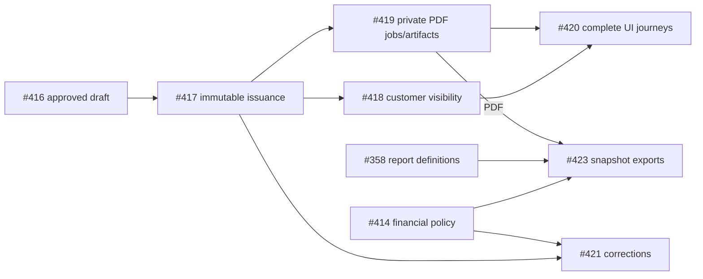

# V1 source, deployment and acceptance reconciliation

Evidence checkpoint: **2026-10-16 UTC**. Release decision: **NOT READY — BLOCKERS REMAIN**.
This document supersedes dated execution/status checkpoints, not accepted domain
invariants or historical engineering evidence. It is a working evidence register;
it does not declare the full audit or V1 implementation finished.

## 1. Independent baselines

| Baseline | Observed fact | Limitation |
| --- | --- | --- |
| SOURCE_BASELINE | Fetched `origin/main`: `30c3edee7002021429978b3478150d63385d75f7` | Latest merged source, not proof of independent acceptance of every feature |
| DEPLOYED_BASELINE | VPS API/Admin/Web/media-worker images select that exact SHA; migrate exited 0 | Authenticated live customer/operator journeys were not repeated during this read-only audit |
| RELEASE_REQUIREMENTS | Current owner directive; V1_MASTER_PLAN outcome/exit gates; accepted ADRs; issue acceptance; later approved staff credit/store invoice scope | Old sprint ownership, scheduling and fixture instructions are historical |

Read-only VPS evidence: clean detached checkout at that SHA; 61 applied migration
names and checksums match source, no missing migration; read-only Prisma comparison
reports no schema drift; 98 tables. API/Admin/Web/Postgres/Redis/object-store/ClamAV
healthy, media-worker running, migration successful. HTTPS `/`, `/admin/login` and
`/api/v1/health/ready` return 200; `nginx -t` passes. These probes do not accept
authenticated mutations or prove a completed sale.

| Image | Verified running/published digest |
| --- | --- |
| api / media-worker | `sha256:4212412d6928f9e52b14b24032a61fc33955118e41681f05f1de1b759b87a5d5` |
| api-migrate | `sha256:12494a8b554c0b7f6afb4d964f5b7c5e820b8a02991198b4f00e069c5778dbd2` |
| admin | `sha256:f09604fe047d580ced84733ec3582b8763b6ae2f678e7eeb3a263a01560bebf2` |
| web | `sha256:5c175eab1a6818c439f47ac5517370e26927627a3c9b6731cf299ef9e66541c1` |

Operational limits rechecked on 2026-10-16, not changed: 38 GiB disk / 18 GiB used /
20 GiB available; 3915 MiB RAM / approximately 1149 MiB available, no swap. The
media-worker has no healthcheck by design; it is running, not independently
accepted as healthy by a nonexistent probe. No production export, seed, schema
write, container patch, image build or deployment was performed by this audit.
Previous release backup/restore evidence remains historical; a future release
requires its own fresh verified backup and authorized rollout.

Private configuration was inspected only as safe projections: SMS mode `smsir`,
key present, all four distinct template slots configured, environment-managed
secret/template source, 5000 ms timeout. Payment mode remains **disabled**.
Configured does not mean provider/handset acceptance. Do not record secret values,
OTP, destinations, signed URLs, customer rows or raw environment in this register.

Three real runtime/build gaps were identified:

1. Actual selected images are current, but API runtime `IMAGE_TAG` still contains
   the previous release SHA (`e0edb4e9385bed754b90312524f0bd1f9d9d9016`). The official
   deploy updates the private rollback/version record after container creation;
   env-file precedence leaves stale runtime provenance. PR #440 binds runtime
   IMAGE_TAG/APP_VERSION to the selected image without moving the backup/migration
   or rollback-record boundary. This is a metadata defect, not evidence of old code.
2. ClamAV reports engine 1.5.4, signature version 28137 dated 2026-09-28. Healthy
   process status does not accept current signatures. This was rechecked on
   2026-10-16; current CDN reachability was not re-probed. #393 remains open.
3. Read-only inspection of the actual API image found 42 compiled integration
   specs and two Vitest configurations in `/app/dist`. This is artifact leakage,
   not proof of exposed test routes. PR #446 separates production compilation,
   preserves the API/media-worker entry paths, clears stale output and verifies
   emitted artifacts. The live image has not been replaced.

## 2. Repository and issue inventory

Initial complete GitHub enumeration: **149 issues** (47 open, 102 closed),
**290 PRs** (5 open, 241 merged, 44 closed); all issue requirement bodies read.
All 359 issue comments and timeline references were retrieved for reconciliation;
retrieval is not a claim that every historical acceptance assertion is verified.
There are now **299 PRs** (14 open, 241 merged, 44 closed). Ten focused PRs
#439–#448 cover ongoing PDF work, findings, regression coverage and this register;
none has been merged or deployed in this audit. The
[branch register](V1_BRANCH_REGISTER.json) enumerates 35 actual remote branches
from `git ls-remote --heads`, not the symbolic `origin` HEAD alias, and current
PR heads/review/mergeability. #386 is conflicting; the three older dependency
PRs are behind main; the ten focused PRs remain review-gated.
The machine-readable [issue register](V1_ISSUE_REGISTER.json) separates disposition,
source anchors, related PRs and remaining evidence; no closed state is treated as
proof of successful live acceptance.

Verified issue changes in this audit:

- #12 reopened with the actual enforced protection settings and review dependency.
- #358 reopened: operational reports exist, but the expanded full reporting scope
  still depends on #421/#422/#423; the original no-reports statement is historical.
- #422 reopened: deployed cost-method configuration explicitly leaves valuation
  inactive. The owner requested this. No cost ledger/history or activation is claimed.
- #215/#216/#308 formatting repaired (wrapped/literal-newline bodies); requirements preserved.
- No new issue closure. #24 is a documented duplicate of #23; #357 is explicitly
  superseded by #349. Preserve these links rather than recreating implementations.
- #114 stays closed under its documented handoff to #403. Operator attests actual
  customer OTP receipt/login; #403 retains transactional, failure/replay and complete
  session lifecycle acceptance. Do not erase that evidence or claim all SMS accepted.

After these reopenings there are **50 open / 99 closed** issues. Re-fetch counts
before final release; they are a checkpoint, not an automatic synchronization job.

Historical review reconciliation found 119 merged PRs with another author's
approval on the exact final head. This is review evidence, not acceptance of all
their business/runtime criteria. ADR-0003 specifies the unit, schema/contract
impact, rounding/allocation, six examples and tax/invoice exclusions; PR #44 has
exact-head independent approval. That accepts the decision artifact, not every
criterion of #13: migrations #38/#40 precede its latest recorded closure. The available
event timeline records one closure and no reopening. Historical body changes or
an authorized exception require further reconciliation before accepting the
sequencing gate. No unauthorized financial
change is inferred. Downstream payment/tax/invoice operation and other criterion
mappings remain separate; `auditComplete` is false.

The 80 registered local worktrees include eight missing directories and five
other dirty worktrees (three with tracked changes). Registrations, other work,
and the original untracked logo files were preserved; nothing was pruned/reset.

Main contains 1398 tracked files, 46 decorated API controllers / 205 declared HTTP
routes, 40 Admin page entries, 19 Web page components, 26 contract files,
61 migrations and 408 test files. Counts are inventory, not completeness metrics.

## 3. Source → API → UI → database → tests → runtime traceability

Legend: **present** means source included in the verified running image, not live
business acceptance. **partial** identifies a concrete missing part. Tests below
are source anchors; baseline suite evidence follows separately. No percentage or
implicit green status is assigned to unperformed acceptance.

| Capability / issues | Source / API and UI anchors | Database / test anchors | VPS status and required action |
| --- | --- | --- | --- |
| Staff password/MFA, refresh/CSRF, current RBAC #47/#49/#74/#400 | `modules/auth`; Admin `lib/api/client.ts`, `auth` and fresh-MFA dialog | Auth session/principal/staff integration, guard HTTP, `admin-fresh-auth`, `admin-sessions`; candidates #445/#447 | Present; cross-tab rotation/replay race reproduced locally and fixed in unmerged #447. Seven genuine-token idle/MFA boundary cases in #445. Live operator single-tab symptom remains unaccepted; no TTL guessing |
| Customer OTP #48/#403 | `customer-otp.service.ts`; Web `AuthProvider`/`LoginDialog` | Challenge/session/rate-limit DB tests, OTP HTTP/browser tests | Present; operator confirms handset/login; remaining real lifecycle/failure evidence open |
| SMS adapter/settings/outbox #114/#115/#314/#403 | `modules/notifications`, `modules/outbox`; `/settings/sms` | Template settings/operator claim/outbox integration and redaction tests | Configured; three transactional handset/replay paths not accepted; order-paid blocked by authoritative payment |
| Runtime roles/permission administration #359 | Schema and current effective-permission reader exist; no `/access` write module/page | Role/permission/grant schema; ADR-0014 still Proposed | Not implemented. Review bounded RBAC contract/last-admin/privilege-escalation controls before writes |
| Audit log #354 | `modules/audit`; Admin `/audit` | Audit HTTP/integration/redaction tests | Present; operational audit/privacy UAT remains a release gate |
| Products/variants/IRR/brands/categories/attributes #388/#178 | `modules/catalog`, catalog shared contracts; Admin catalog/brands/categories/attributes | Catalog authoring/idempotency/identifier integration; `admin-279-journey` | Present; full exact live operator create/reload/publish journey remains separate |
| Excel catalog import #178/#189 | Catalog import parser/service; Admin imports | Bounded import parser/service tests, variant migrations | Present; imported data is not production seeded by this task |
| Rich description/Jodit #279/#388 | Shared `RichTextEditor`, media picker; API content sanitizer/description ownership; public RichText | Description/XSS/media-reference integration; editor and browser journey | Present; self-hosted editor; product editor does not implement articles |
| Image upload/process/public projection #162–#165/#226 | `modules/media`, API worker entry; Admin gallery/Web MediaGallery | Media DB/processing/scanner/storage tests and publish-to-discovery E2E | Present; signature freshness #393 and controlled live media acceptance remain |
| Video authoring #388 | Public media type/player is not a complete authoring/processing pipeline | Current image worker contract does not establish READY video | Unsupported authoring remains open; no fabricated READY video |
| Warehouses/balances/ledger/reservations/transfers #4/#261 | `modules/inventory`; Admin warehouse/inventory/reservations/transfers | Immutable movements and locked balances; PostgreSQL and two-warehouse ledger E2E | Present; operator stock reconciliation acceptance remains |
| Suppliers/PO/receiving #329/#339/#343/#345 | `modules/suppliers`, `modules/purchasing`; Admin suppliers/PO | Immutable receipt-to-movement links; purchasing concurrency; real partial/final receipt E2E | Present; no supplier payment or fabricated cost history added |
| Stocktake #347/#352 | `modules/stocktake`; Admin stocktake list/detail/history | Stocktake migration/constraints and integration; `admin-stocktake` | Present. Candidate #444 adds exact two-location upward/downward browser reconciliation and passes CI; not merged/deployed. Live physical count/approval unverified |
| Inventory costing/valuation #422 | Versioned `inventory-cost-policy.service.ts`; Admin settings | Cost-policy migration and concurrency tests | Configuration present and intentionally inactive; cost ledger/attribution/valuation missing. Do not activate or infer opening costs |
| Catalog discovery/home/mobile #258/#401 | Web Home/Product/Category/Search, HeroSlider, MobileBottomNav; public catalog | Web component/a11y and desktop/mobile tests | Present; controlled live responsive/navigation UAT still required |
| Guest/auth cart and merge #236/#250/#269 | `modules/orders` cart/guest/merge controllers; Web CartProvider/CartPage | Opaque guest token, cart versions/idempotency; real PostgreSQL/cart browser tests | Present; refresh/recovery is not fake success, full live customer sale not accepted |
| Checkout/address/shipping/order #237/#267/#389 | Checkout/customer-self/shipping APIs; Web Checkout, AccountAddresses, Orders/Detail | Order/address snapshots, shipping policy; checkout/customer ownership integration | Present; owner addresses and one truthful provider handoff still need final live acceptance |
| Customer profile/security #389 | `/customers/me`, Web AccountProfile/Addresses/Security | Owned self mutations/default-address invariant and API/browser tests | Present; email verification/marketing/privacy export/closure missing contracts remain explicit scope dependencies |
| Staff order/customer records #349/#350 | Customers/staff-order APIs; Admin customer/order screens | Customer lifecycle and server-priced order integration, real staff-order E2E | Present; no public credit checkout or caller-supplied total |
| Payment verification/reconciliation/refund #6 | `modules/payments`, Web Payment/Return; Admin payment evidence | Initiation/verification/refund/reconciliation PostgreSQL tests | Provider disabled; real controlled payment/callback/refund/reconciliation acceptance OPEN. Never infer PAID from redirect |
| Fulfillment/dispatch/delivery/tracking #308/#310/#312/#356 | Orders fulfillment/pick/shipment controllers; Admin shipments and customer tracking | Pick proof and shipment events; order/shipment integration | Present; real authoritative paid path and transactional SMS depend on controlled domain acceptance |
| Staff credit/receipts/aging #336/#338 | `modules/credit`, Admin customer credit; Web own credit | Immutable ledger/allocations/opening/approval migrations; credit/sale integration and E2E | Present; financial operator acceptance still tracked; public checkout remains gateway-only |
| Credit cancellation/returns/refund obligation #431 | `credit-return.service.ts`, Admin credit returns/owned Web projection | Compensation/zero-price/immutable refund evidence; rollback/concurrency | Present for accepted sellable credit return scope; controlled financial acceptance pending |
| General customer returns/after-sales #348 | Credit-only return path cannot satisfy general paid-order returns | General RMA/inspection/disposition/refund lifecycle not implemented | Partial; implement normal order ownership/approval/stock/refund linkage; quarantine policy must be explicit |
| Seller/tax policy and proforma #415/#416 | Invoice policy/draft/quote APIs; Admin invoice settings/drafts | Append-only policy revisions, isolated drafts and exact BigInt allocation tests | Present; operator-configured commercial policy only; no assumed tax/fiscal compliance |
| Numbered immutable issuance #417 | `invoice-document.service.ts`; Admin issue/history | Unique numbering and immutable SQL guards, issuance concurrency | Present; no direct payment/stock edits; operator issuance acceptance still open |
| Customer publication/revocation #418 | `invoice-publication.service.ts`; Admin publish/revoke, Web AccountInvoices | Ownership/current-session/no-store/version/replay and document integration | Present at exact baseline; live two-customer publish/read/revoke acceptance not performed |
| Persian A4 browser print #420 | Existing Admin/Web issued document views and local brand/font | Print layout/component tests, preview artifact | Present; browser print is not private downloadable PDF service |
| Private PDF artifact service #419 | #439 adds pure escaped, bounded, asset-pinned template only | 24 template units + one real sandboxed Chromium PDF/browser test | Template PR not deployed; queue/job/private storage/authorized download/worker still missing |
| Corrections/cancellation/credit documents #421 | Original immutable invoice persists; no corrective document lifecycle | Existing credit entries do not replace invoice correction references/deltas | Not implemented; preserve originals, serialize linked corrections, separate visibility/refund/stock effects |
| Operational reports #358 | `operational-report.service.ts`, shared operational-reports contract; Admin `/reports` | Real day/week/month order/settlement/refund/top-SKU/debtor queries; HTTP/PG/UI/browser | Present subset; valuation/corrective document/private export scopes remain open |
| Private CSV/Excel/PDF exports #423 | No bounded owned snapshot job/download surface | Existing ExcelJS catalog import is not a report export service | Not implemented; immutable filter/snapshot, formula prevention, current permission/expiry/resource limits required |
| Articles/tags/revisions/editorial workflow #125 | `modules/content` contains only sanitizer + test; no article model/controller/Admin page | Product Jodit cannot evidence article lifecycle/revisions/media ownership | Not implemented; reuse editor/sanitizer with separate content media contract |
| Public SSR/metadata/canonicals #124/#126 | Web remains React/Vite SPA; accepted ADR-0012 specifies route-by-route Next App Router | Existing client metadata does not prove useful initial HTML/parity | Not implemented; no custom Vite SSR, duplicate business engine or hidden-content workaround |
| Dynamic sitemap/robots/feed/schema #127/#129 | Discovery contracts/plans exist; commerce/content event-driven projections incomplete | Existing discovery checks are not backend/public route acceptance | Partial/not implemented; lifecycle freshness, no draft/private leakage, full-graph parity required |
| Discovery budgets/crawler governance #123/#130 | Existing audit tooling and policy docs | CI contract checks and explicit live production checks | Partial; verify real crawl/performance and opt-in scope. AI retrieval #128 is deferred |
| Deployment/backup/rollback #8 | Official compose/deploy/backup/restore and SHA image workflows | Previously restored fresh release backup/media checks; release script tests | Exact baseline verified; fresh future restore and current rollback/monitoring acceptance still required |
| Telemetry/alerts #136 | Structured logger/request IDs, health/readiness, queue/outbox state | Logger redaction tests; readiness/worker tests | Partial; current release-critical alert delivery/load/recovery evidence not established; runtime provenance fix #440 pending |
| Repository/supply chain #12/#51/#255 | Enforced protection; dependency/CodeQL/Sonar workflows | #441 patches six dev/build transitive alerts; #442 blocks unknown audit outcomes; #448 requires configured/CI Redis integration coverage | Settings active; candidates pass required checks but are not merged. Main alerts remain until patch merges; Sonar org-account #213 external confirmation remains |

Paths abbreviated `modules/x` refer to `apps/api/src/modules/x`; contracts are
`packages/contracts/src`, Admin pages are `apps/admin/src/app/(dashboard)`, Web
pages/components are `apps/web/src`, browser specs are `e2e/tests`, and schema/SQL
constraints are `apps/api/prisma`. Inventory supports **presence**, not a claim that
each original assertion is covered. Follow the linked issue criteria for acceptance.

## 4. Test and release evidence

Baseline PR #434 head `8303100980dae7aad577047f9ed6a541467d88d6` has an identical
source tree to merge `30c3edee7002021429978b3478150d63385d75f7`.
CI [38676845199](https://github.com/Hordekiller/Iraniyaragh/actions/runs/38676845199):
3083 unit tests, 411 PostgreSQL tests, 134 browser tests pass; zero final browser
failures/flaky results. Five existing opposite-viewport browser skips are reported
separately, not passed tests. The additional Node suite reports 10 conditional
skips; do not use them as acceptance evidence. Required security/quality checks pass.
Publish Images [38683967529](https://github.com/Hordekiller/Iraniyaragh/actions/runs/38683967529)
and prior authorized staging deployment passed; digest/runtime/migration verification
above independently confirms current parity. Prior restore and release detail is
linked from [#418 evidence](https://github.com/Hordekiller/Iraniyaragh/issues/418#issuecomment-6187669817).

| Slice | Commit / PR | Evidence at this checkpoint | Release state |
| --- | --- | --- | --- |
| Fixed bounded Persian PDF template | `4992028cfffe1de3f9196fb952516415e26874c6`, #439 | 24 focused units; full CI: API 1740/Admin 947/Web 420, PG 411, browser 135 pass / 5 existing viewport skips; all nine checks green. CodeQL originally found case-sensitive malicious-HTML test regex; assertion expanded/fixed, not suppressed | Independent review required; no production PDF service/deploy claimed |
| Runtime provenance | `70c29a3ba8c1e312957f1bcf6e585c6d2ffb2637`, #440 | Compose regression 2 fail before / 2 pass after; all six application service image/runtime versions aligned using disposable public-example config only | All nine required checks pass; browser 134 pass / 5 existing viewport skips. Independent review pending, not deployed |
| Transitive security patches | `1422dc24d3bb06f971703645d17f74f9e94e6825`, #441 | Frozen install, Prisma, lint/types/unit/build, PG 411, OpenAPI and clean exact-head validation pass; real full + production pnpm audits report zero advisories | All nine required checks pass; browser 134 pass / 5 existing viewport skips. Independent review pending; six main alerts are not yet resolved on main |
| Audit gate fails closed | `0916b7afff6286325f7cf0e436b3936cec4012a7`, #442 | Original regression 1 pass/16 fail; 24 final tests pass, no skips; real production audit passes; empty/invalid/timeout/output-cap/exception/unknown results cannot pass or disclose raw errors | All nine checks pass; E2E 133 pass / 1 flaky that passes retry / 5 existing skips / zero final failures. Independent review pending; no application/provider/runtime change |
| Two-location stocktake reconciliation | `93c1d278ee685bea6b0bfc44ba9c78d6e791d019`, #444 | Actual UI partial count/save/reload/approve/history and persisted links; exact receipt/stocktake count and signed movement/balance/reserved/available assertions for two locations. Local desktop/mobile 2/2; full CI PG 411, browser 134 pass / 5 existing skips | All nine checks pass; independent review and live acceptance pending, not deployed |
| Staff idle/fresh-MFA boundaries | `9d8f13e084878d400f30b24577fa910ce5f3989e`, #445 | Seven new real PostgreSQL/HTTP cases: genuine past-issued JWTs, access refresh before idle expiry, original MFA/absolute expiry preserved, expired/revoked sessions denied, sensitive reauth distinct from navigation. CI PG 418/418, browser 134 pass / 5 existing skips | All nine checks pass; test coverage only, not a live bug fix or TTL change |
| Production API artifact boundary | `2688d3b3bafc2a66b7f0a561a97cec24b9480d11`, #446 | Actual old build rejects; clean production output excludes integration/config/helper artifacts and preserves two runtime entries; injected stale output rejects then clean rebuild removes it; fresh isolated readiness passes. CI PG 411, browser 134 pass / 5 existing skips | All nine checks pass; no live image replaced |
| Cross-tab protected replay | `6c86c85ae3d52d15a407cdc22de4752197b9e37a`, #447 | Real before-fix protected replay receives 401 instead of 200. Existing cookie lock now retained through coalesced replay bodies; exact one replay/body/key/generation checks preserved. CI units API 1716/Admin 953/Web 420; PG 411; browser 136 pass / 5 existing skips, zero final failures/flaky | All nine checks pass; independent review and authorized deployment/operator acceptance pending; #400 stays open |
| Required live-Redis integration | `36628c9536aa85c26f9dcb7d66d9263312cd2747`, #448 | Root Turbo forwards REDIS_URL/CI. Configured unavailable Redis previously exited 0 with nine skips; now both security suites fail with a sanitized diagnostic. Fresh root PG/live-Redis gate 411/411, no skips; CI units API 1719/Admin 947/Web 420; browser 134 pass / 5 existing skips | All nine checks pass; independent review pending. Test infrastructure only; no provider/rate-limit/application/schema change |

The listed heads are independent branches based on the same main, **not** one
integrated release tree. Their individual green runs do not accept their eventual
combined merge. PR #443 passed all nine checks at `b829301f43ccceb27c5223bad4b3cae4b9e4a277`;
this documentation refresh requires checks on its new exact head.

Triage limitations are explicit:

- #442 CI [38741668467](https://github.com/Hordekiller/Iraniyaragh/actions/runs/38741668467):
  `web-smoke.spec.ts`, mobile “remains usable while the approved Enamad image
  request is pending” initially fails `Application resources must settle`
  (expected pending count 0, received 1); retry #1 passes. The completed run has
  no uploaded trace artifact. The exact pending request and cause are unverified;
  do not declare an application bug or claim this flake fixed.
- #447 CI [38787050022](https://github.com/Hordekiller/Iraniyaragh/actions/runs/38787050022)
  and #448 CI [38789001857](https://github.com/Hordekiller/Iraniyaragh/actions/runs/38789001857)
  finish without final browser failures/flaky results. The local #447 regression
  also exposed an invalid-URL error in a general asset-tracker helper during new-tab
  setup; the test instead waits for actual inventory HTTP responses. This is not
  conflated with the independently reproduced bearer-revocation race.
- Local integration runs on used browser/interrupted test data were rejected, not
  counted as passes. Fresh task-owned disposable databases give 411/411 with real
  configured Redis, without weakening an assertion or changing a financial command.
  #448 also prevents silently losing nine Redis cases through Turbo environment
  filtering. No staging/production/shared database was reset for these tests.

## 5. Historical implementation recovery

Branches were inspected before choosing new work. Commit presence outside main is
not proof of a missing feature: squash merges leave historical branch commits
outside the main ancestry. Compare the actual changed behavior and current files.

- `feat/invoice-pdf-private-artifacts` contains only an ADR commit, no hidden PDF
  service. Reuse the ADR/template #439; implement jobs/worker/download coherently.
- `feat/178-slice-g1-g2-configurable-settings-rbac` contains an old settings store,
  **not** role administration. It embeds an assumed VAT/default approval policy;
  do not restore it over accepted empty-by-default invoice policy or applied migrations.
- `feat/129-dynamic-discovery` contains the rendering ADR acceptance, not a hidden
  sitemap/blog runtime. Main already records the accepted decision.
- `lane-b/storefront-completion`, archived catalog and inventory candidate branches
  contain historical UI/API implementations. Current main integrates their evolved
  successors; avoid copying old route clients, auth, money or fixtures back in.
- #386 includes older nginx routing work already merged as #385 (`092cc92`) plus
  stale documentation; current main adds signed-upload/quarantine restrictions and
  real-Web E2E beyond that head. Do not revert current security or tests to restore
  the old branch. Resolve its remaining documentation overlap against this audit.
- PR #390 remains closed/superseded. No revival.

## 6. Dependency-aware execution slices

Each slice keeps its own reviewed PR. Rebase a dependent branch after the dependency
merges, then rerun exact-head checks and review; an old green run cannot authorize
a new merge. No fixture/provider bypass or direct financial/stock mutation.

[Structured dependencies and release gates](V1_DEPENDENCIES.json) distinguish
declared issue dependencies from current implementation and acceptance state.

| Order / issue | Scope, implementation and dependencies | Acceptance / rollback |
| --- | --- | --- |
| S0 #12/#51/#136 | Review/merge #441, #442, #440, #446 and #448 with strict latest-main checks; reconcile CI/testing-doc overlap. Security patches stay narrow, no #77 major upgrade train | Real full/prod audits, fail-closed negative tests, exact runtime provenance and production artifacts; revert code via new reviewed commit, keep protections enforced |
| S1 #347/#352/#351 | Review/merge tested #444 exact two-location upward/downward browser chain; then operator acceptance. Reuse real receipt/count/approve APIs; no production inventory writes | Both admin viewports, exact movement counts/before/after/balance/reserved/available and persisted links; test-only rollback has no schema effect |
| S2 #400 | Review/merge #445 boundaries and #447 demonstrated cross-tab fix; perform live operator idle acceptance and retain sanitized failure evidence for any remaining single-tab symptom | No speculative TTL extension; preserve fresh MFA/revocation and one exact replay. Current individual CI green does not prove deployed/operator completion |
| S3 #419/#420 | Reviewed template #439 → versioned private job contract/schema → bounded isolated renderer image → private artifact ownership/download → Admin/Web integration | Current permission/visibility on every read, hash/revision/expiry, actual Persian PDF extraction/visual checks, timeout/restart/SSRF tests. Additive migration; disable jobs before code rollback, never delete invoices |
| S4 #421 | Append-only correction/cancel documents with unique linked issuance, immutable original and effective signed delta; monetary effects only through accepted order/credit/return domains | Concurrent corrections/replays, caps, original still accessible, no fake refund/PAID/stock. Additive schema; preserve history on rollback |
| S5 #358/#423 | Bounded private CSV/Excel snapshot jobs from accepted report definitions, then PDF adapter after S3; same snapshot totals and permission filters | Formula/PII injection, >2^53 IRR, expiry/revocation, pagination/restart/resources/reconciliation. Disable new jobs rather than destroy financial snapshots |
| S6 #348 | General owned paid-order returns/inspection/disposition with existing inventory/refund commands. Credit-only scope #431 remains separate | Real PostgreSQL quantity/money caps/rollback/replay, customer A/B, staff approval, no saleable restock for quarantine without accepted disposition policy |
| S7 #359 | Review bounded runtime RBAC ADR/API, system-role immutability, last-admin invariant, grant ceilings/expiry/atomic audit and live permission invalidation; then API/Admin | Privilege escalation, concurrent last-admin removal, forbidden/self-grant/replay/role expiry and fresh MFA; additive migrations, no secret/privilege reset |
| S8 #125 | Article/tag/revision workflow and governed content-media ownership, shared Jodit/sanitizer, Admin draft/review/publish | Stored sanitized output, role/workflow/version/replay checks; no parallel product media ownership or unreviewed arbitrary upload |
| S9 #126/#129/#127 | Execute accepted route-by-route Next public migration, then source-owned sitemap/robots/structured-data/feed projections and invalidation | Useful initial HTML, canonical/price/lifecycle parity, draft/private exclusion and purge behavior, actual crawl/browser tests. Keep compatibility/rollback strategy per route |
| S10 #123/#130/#136/#393 | Operational alert/load/recovery evidence, Clam signature update resolution, resource limits and crawler/discovery budgets | Verify alert receipt, backup restore, rollback, restart/replay, signature freshness, disabled-provider safety; no green from process health alone |
| Final #388/#389/#403/#413/#424/#363 | Reconcile all accepted source/CI evidence and perform operator/provider-owned acceptance with fixture mode off; only then authorized exact-SHA release | Fresh restored backup, all images/digests/migrations, real admin/customer/provider paths, no unresolved review/required check; record release decision |

Policy/external boundaries: keep cost valuation inactive per owner; missing opening
cost evidence is not engineering permission to fabricate it. No assumed tax rate.
Fiscal/Moadian, native apps, full accounting, loyalty/reviews, AI retrieval #128,
multi-provider #141 and major upgrade train #77 are outside approved current V1.
Basic accepted content/technical SEO remain V1 and must not be deferred with AI.

## 7. Enforced review and remaining release gates

GitHub main protection was configured and read back during this audit: strict
up-to-date checks bound to GitHub Actions app 15368 (`quality`, `database`, `e2e`,
`sonar`, `dependency-review`, `production-audit`, `Analyze (actions)`,
`Analyze (javascript-typescript)`) plus GitHub Advanced Security app 57789 (`CodeQL`).
One approving review, last-push approval separation, stale dismissal, resolved
conversations, linear history and administrator enforcement; no force push/deletion.
Current PRs report REVIEW_REQUIRED. Self-review cannot satisfy an independent
approval. Historical solo exceptions do not bypass these live controls.

Concrete release blockers remain: missing source work in the matrix; exact final
PR CI/review; real SMS transactional/session acceptance #403; payment disabled and
no controlled authoritative payment/reconciliation acceptance; live admin/customer
UAT including idle-session repro; Clam signatures #393; current monitoring/alert/
rollback/load evidence; inactive cost valuation/opening-policy evidence; Sonar
organization-admin confirmation #213. Do not call all of these one generic
“waiting for manual tests” blocker—several still require engineering.

The source/CI/runtime observations above justify continued implementation and
controlled acceptance preparation. They do **not** justify a V1 completion claim,
live payment activation, bulk issue closure or a new production deployment.
